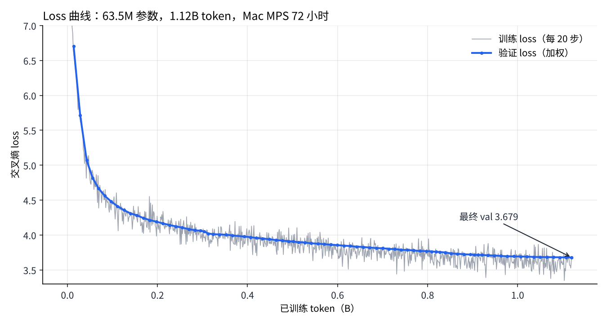
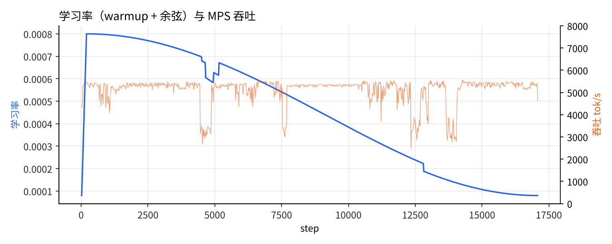
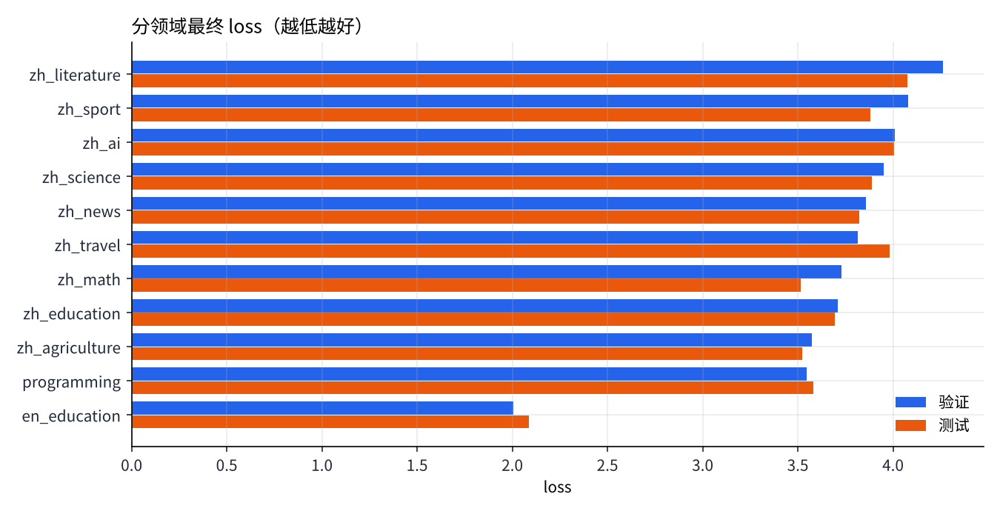

# LLM_test：在一台 Mac 上用多智能体 loop 从零预训练中文小语言模型

本仓库记录了一次完整的**从零预训练**实验：在 Apple Silicon Mac 的 GPU（MPS）上，用 72 小时把一个 **63.5M 参数**的 Decoder-only 语言模型在 **1.12B token** 的中英文行业语料上训练完成。

整个流程（数据下载与清洗 → 从头训练 32k BBPE 分词器 → 模型结构自检与吞吐基准 → 训练 → 评估）由一个**五智能体协作的 loop** 自动执行：每个智能体负责一类决策，所有决策和理由都记录在消息总线里，可断点恢复、出错自动重启。

| 项目 | 结果 |
|---|---|
| 模型 | Decoder-only Transformer，63.5M 参数（d=640，10 层，GQA 10/2 头，SwiGLU，RoPE，Pre-RMSNorm，tied embedding） |
| 数据 | BAAI/IndustryCorpus（ModelScope，固定 revision）11 个领域，清洗去重后 9.6 亿字符 → 5.6 亿唯一 token |
| 分词器 | 从头训练的 32,000 词表字节级 BPE（中文约 1.6 字/token） |
| 训练 | 17,091 步 × 65,536 token = **1.12B token**（约 2 轮），bf16，Mac MPS，约 5,000 tok/s |
| 验证 loss | **3.679**（困惑度 39.6） |
| 测试 loss | **3.635** |
| 耗时 | 72 小时预算内完成（数据 + 分词器约 3 小时，训练约 63 小时） |



---

## 目录

- [快速开始](#快速开始)
- [模型结构](#模型结构)
- [数据与分词器](#数据与分词器)
- [五智能体 loop 的设计](#五智能体-loop-的设计)
- [本次运行中智能体做了哪些决策](#本次运行中智能体做了哪些决策)
- [评估结果](#评估结果)
- [经验与局限](#经验与局限)
- [仓库结构](#仓库结构)

---

## 快速开始

### 环境

```bash
python -m venv .venv && source .venv/bin/activate
pip install -r requirements.txt          # torch>=2.3, numpy
```

Apple Silicon 用 `--device mps`，NVIDIA GPU 用 `--device cuda`，也可以 `--device cpu`。

### 用训练好的模型生成

模型权重（`best.pt`，254MB，内嵌分词器）超过 GitHub 单文件 100MB 的限制，放在本仓库的 **Releases** 页面。下载后放到 `checkpoints/best.pt`：

```bash
python -m decoder_from_scratch.infer \
  --checkpoint checkpoints/best.pt --device mps \
  --prompt "人工智能的发展" --method sample --top-k 40 --top-p 0.9 --temperature 0.8 \
  --max-new-tokens 120 --repetition-penalty 1.2 --no-repeat-ngram-size 4
```

> **提示词请用半角标点**（`,` `.` 而不是 `，` `。`）。训练语料里几乎没有全角逗号和句号，全角标点会把模型带到很少见的 token 上，输出明显变差。
> 小模型贪心解码容易复读，建议用采样并开启 `--repetition-penalty` / `--no-repeat-ngram-size`。

### 复现训练

```bash
# 在仓库根目录执行；默认运行目录 decoder_from_scratch/runs/multiagent_pretrain_v1
# macOS 上用 caffeinate 防止睡眠；异常退出 2 分钟后守护脚本自动用最新代码重启
nohup caffeinate -is bash decoder_from_scratch/multiagent/run_loop.sh >/dev/null 2>&1 &

python -m decoder_from_scratch.multiagent.loop status    # 进度 + 最近的智能体消息
python -m decoder_from_scratch.multiagent.loop stop      # 保存后停止（删除 STOP 文件后可续跑）
python -m decoder_from_scratch.multiagent.loop restart   # 改代码后保存并用新代码重启
```

数据会从 ModelScope 下载（12 个 `.jsonl.gz` 文件共约 11.8GB），加上编码后的 token 与检查点，需要约 20GB 磁盘。预算、配比等参数在运行目录的 `config.json` 里修改（见 [`results/multiagent_pretrain_v1/config.json`](results/multiagent_pretrain_v1/config.json)）。

---

## 模型结构

代码在 [`decoder_from_scratch/model.py`](decoder_from_scratch/model.py)，全部手写，只依赖 PyTorch：

| 组件 | 实现 |
|---|---|
| 位置编码 | RoPE（旋转位置编码） |
| 注意力 | GQA：10 个 Query 头共享 2 组 K/V（head_dim 64），`scaled_dot_product_attention`，支持 KV Cache |
| 归一化 | Pre-RMSNorm |
| FFN | SwiGLU（中间层 1728） |
| 输出层 | 与 token embedding 共享权重 |
| 规模 | hidden 640，10 层，上下文 1024，参数 63.5M（其中 embedding 20.5M） |

**规模怎么选的**：结构智能体先对 4 个候选（25M / 39M / 64M / 100M）分别测 fp32 和 bf16 的实际吞吐，再按"训练 token ≈ 20 × 参数量"（Chinchilla 计算最优）在剩余时间内挑最合适的一个：

| 候选 | 参数 | bf16 吞吐（tok/s） | 72h 可训 token | token/参数 |
|---|---|---|---|---|
| xs_d384_l8 | 24.9M | 9,543 | — | — |
| s_d512_l8 | 38.9M | 7,230 | — | — |
| **m_d640_l10** | **63.5M** | **4,878** | **约 1.0B** | **15.9（最接近 20）** |
| l_d768_l12 | 100.1M | 3,370 | — | — |

训练开始前还会做三项自检：因果性（未来 token 不影响当前输出）、KV Cache 与完整前向一致、bf16 下能把小 batch 过拟合到接近 0，在 CPU 和 MPS 上都通过。

---

## 数据与分词器

**来源**：[BAAI/IndustryCorpus](https://www.modelscope.cn/datasets/BAAI/IndustryCorpus)（Apache-2.0，固定 revision `8a03761a`），每个领域取一个文件，配置见 [`decoder_from_scratch/configs/scale_sources_v1.json`](decoder_from_scratch/configs/scale_sources_v1.json)。

**清洗**（[`multiagent/cleaning.py`](decoder_from_scratch/multiagent/cleaning.py)）：控制字符与空白规范化 → 长度、语言占比、导航/广告/版权行等规则过滤 → 全局精确去重 + 段落级近重复去重 → 按文档哈希划分 train / val / test（每领域各约 300 篇）。

| 领域 | train 文档 | train 字符 |
|---|---|---|
| zh_education | 139,663 | 216.1M |
| zh_science | 101,828 | 128.0M |
| zh_news | 86,792 | 98.1M |
| zh_literature | 63,140 | 98.6M |
| zh_math | 47,612 | 89.3M |
| programming | 46,984 | 93.0M |
| en_education | 14,782 | 77.1M |
| zh_travel | 39,039 | 48.7M |
| zh_agriculture | 30,437 | 38.8M |
| zh_ai | 20,175 | 37.4M |
| zh_sport | 17,219 | 19.5M |

`en_programming` 去重后验证/测试文档不足，被数据智能体隔离、不参与训练。

**分词器**：[`tokenizer_training/`](tokenizer_training/) 是一个纯 Python 的字节级 BPE 训练工程：按 Unicode 类别预分词（空白 / 字母含汉字 / 数字 / 符号），初始 256 个字节，用"相邻对计数 + 堆 + 倒排索引"增量合并到 32,000 词表，没有 UNK。本次用 1,000 万字符训练，耗时 7 分钟。训练好的分词器在 [`results/multiagent_pretrain_v1/tokenizer/`](results/multiagent_pretrain_v1/tokenizer/)。

平均每 token 字符数：中文 1.44–1.84，英文 2.28，代码 1.87。

---

## 五智能体 loop 的设计

代码在 [`decoder_from_scratch/multiagent/`](decoder_from_scratch/multiagent/)，详细说明见 [`MULTIAGENT_LOOP.md`](decoder_from_scratch/MULTIAGENT_LOOP.md)。

```
              ┌──────────── 决策智能体 decision_agent.py ────────────┐
              │ selftest → data_acquire → data_merge → tokenizer →   │
              │ encode → model_select → train ⇄ review → final_eval   │
              └──┬────────────┬──────────────┬─────────────┬─────────┘
          directive│     directive│      directive│    directive│
        ┌─────────▼──┐  ┌──────▼──────┐ ┌──────▼─────┐ ┌─────▼──────┐
        │ 数据清洗    │  │ 结构/算法    │ │ 训练执行    │ │ 测试评估    │
        │ data_agent │  │ architect   │ │ trainer    │ │ evaluator  │
        └────────────┘  └─────────────┘ └────────────┘ └────────────┘
     ─────── 消息总线 events.jsonl（谁→谁、类型、内容、理由）＋ 黑板 state.json ───────
```

| 智能体 | 职责 |
|---|---|
| 决策 | 编排阶段，审核其他智能体的报告，按明确规则做决策（重试/隔离领域、批准训练计划、缩短/延长计划、回滚、调配比、结束），每条决策写明理由 |
| 数据清洗 | 下载、清洗、去重、划分、调用分词器工程训练、多进程编码；训练中可在独立进程补数据 |
| 结构与算法 | 模型自检、候选结构吞吐基准、按计算最优原则选规模 |
| 训练执行与监控 | AdamW（β2=0.95，wd=0.1）、warmup + 余弦、梯度裁剪与累积；按领域权重不放回采样（可精确恢复）；每 45 分钟一段、每 15 分钟检查点；监控 loss / 梯度 / 吞吐 / 非有限值 |
| 测试评估 | 固定验证块的分领域 loss、12 个固定提示的采样/贪心生成与 4-gram 重复率、结束时测试集评估 |

**训练中的决策规则**

1. **稳定性**：连续 3 步非有限 loss，或验证 loss 比最佳高 5% → 回滚到上一个检查点，学习率 × 0.7。
2. **计划调整**：按实测吞吐预测能否在截止前跑完，跑不完就缩短步数，明显富余就延长，余弦终点随之对齐。
3. **防过度重复**：某领域预计重复超过 4 轮 → 在独立进程补数据，补不到就降权。
4. **防遗忘**：某领域验证 loss 连续两次上升而整体在下降 → 该领域权重 × 1.2（上限为初始的 1.5 倍）。

**容错**：每个阶段写回执，中断后从断点继续；守护脚本 [`run_loop.sh`](decoder_from_scratch/multiagent/run_loop.sh) 负责异常重启；72 小时截止时间从首次启动起固定，重启不会延长。

---

## 本次运行中智能体做了哪些决策

完整记录在 [`results/multiagent_pretrain_v1/events.jsonl`](results/multiagent_pretrain_v1/events.jsonl)，可读版在 [`REPORT.md`](results/multiagent_pretrain_v1/REPORT.md)。几个有代表性的：

| 时间 | 决策 | 理由 |
|---|---|---|
| 10-31 14:48 | 隔离 `en_programming` | 去重后验证/测试文档不足 |
| 10-31 17:43 | 作废第一版基准，重新选型 | v1 基准在同一进程测多个候选，内存抖动导致吞吐失真；改为每个候选在独立子进程测试 |
| 10-31 17:48 | 批准 m_d640_l10，17k 步 | 72 小时内 token/参数最接近 20 |
| 11-01 09:44 起 | 多次缩短/延长计划 | Mac 吞吐受系统负载波动（2,800–5,800 tok/s）；后来改为"近 4 段中位数 + 单次最多 ±8%"避免来回震荡 |
| 11-01 ~ 11-03 | 6 次提高领域权重 | zh_travel、zh_ai、zh_math、zh_agriculture 出现"整体下降而该领域上升"的遗忘信号 |
| 11-03 08:47 | 训练完成 | 17,091 步、1.12B token，验证 3.679，测试 3.635 |



学习率曲线上的几处"跳变"就是计划调整造成的：余弦调度的形状依赖总步数，中途改总步数会让当前学习率突变。这是本设计的一个缺陷，见[经验与局限](#经验与局限)。

---

## 评估结果

**分领域最终 loss**（验证集 / 测试集，每领域约 300 篇未参与训练的文档）：



英文 loss 明显更低，是因为一个英文 token（约 2.3 个字母）携带的信息远少于一个中文 token（约 1.6 个汉字），本来就更容易预测；**不同语言/领域的 loss 不能直接比较**，只能和自己过去的值比。

**生成样例**（top-p 0.9，温度 0.8；⟨ 之后是模型续写）：

| 提示 | 第 212 步（14M token） | 第 17,091 步（1.12B token） |
|---|---|---|
| 光合作用是指绿色植物 | ,为土侧."大会"中公手"覆盖人"中,可以在地铁代利亚因边缘给商业,5G5HProE为王译… | 的光合作用,是指在正常的植物光照条件下,通过光合作用吸收了植物光合作用,使得植物中的有害物质包括有害物质… |
| 长江是中国最长的河流， | 气候,食品,石界能凝聚的,制作了医疗卫生,现短,重暴雨,绿队,助营业… | 长江上游的长江支流是中国最大的人工湖.长江流域面积204平方公里,主要水系由北到南… |
| 在直角三角形中，勾股定理指出（贪心） | — | :直角三角形斜边上的中线等于斜边的一半. 直角三角形斜边上的中线等于斜边的一半. … |

模型学会了中文语法、句式和不同文体的"样子"（百科、教材、新闻），但**事实不可靠**（长江的面积、"人工湖"都是编的），贪心解码下复读严重（4-gram 重复率 0.87）。这符合 6000 万参数、10 亿 token 量级模型的预期：语言能力先于知识能力出现，知识需要更大的模型和多一个数量级的数据。

所有评估记录：[`eval_history.jsonl`](results/multiagent_pretrain_v1/eval_history.jsonl)（83 次评估），每次评估的全部生成样例在 [`samples/`](results/multiagent_pretrain_v1/samples/)。

---

## 经验与局限

1. **可调整计划时不要用余弦调度**。余弦学习率依赖总步数，决策智能体中途改步数会造成学习率跳变。后续 A800 上的 0.5B 实验改用 **WSD（Warmup-Stable-Decay）**：衰减开始前学习率恒定，改总步数不影响当前学习率。
2. **基准测试要隔离**。同一进程依次测多个候选会互相影响显存/内存（Mac 统一内存尤其明显），v1 基准因此失真，改为每个候选独立子进程。
3. **计划调整要抗噪声**。Mac 的吞吐受系统负载影响波动很大，按单段吞吐调整会来回震荡；改成"最近 4 段中位数 + 单次最多 ±8%"后稳定。
4. **训练数据的标点会决定推理时的提示写法**。本次使用的 IndustryCorpus 文件里中文逗号、句号几乎都是半角，清洗时也没有统一，模型对全角标点很陌生。后续实验在清洗阶段统一把中文语境下的半角标点转为全角，推理时对提示词做同样的转换。
5. **规模的上限**。63.5M 参数 / 1.12B token 足以学会流畅的语言形式，但学不到可靠的事实，也不能问答。要"各方面都还不错"至少需要 0.5B 参数、20B+ token 和多样化数据（中英文网页、教材、代码、数学），并在之后做指令微调。

---

## 仓库结构

```
├── README.md
├── requirements.txt
├── decoder_from_scratch/
│   ├── model.py  config.py         # Decoder-only Transformer（RoPE/GQA/RMSNorm/SwiGLU/KV Cache）
│   ├── generation.py               # 采样 / 贪心 / beam search，重复惩罚、n-gram 禁止
│   ├── tokenizer.py  data.py       # 分词器加载（BBPE / 字符级）
│   ├── runtime.py  infer.py        # 加载检查点与命令行推理
│   ├── configs/scale_sources_v1.json   # 数据源（ModelScope 路径、sha256）
│   ├── MULTIAGENT_LOOP.md
│   └── multiagent/                 # 五智能体 loop
│       ├── decision_agent.py  data_agent.py  cleaning.py
│       ├── architect_agent.py  bench_worker.py  trainer_agent.py  eval_agent.py
│       ├── smoke.py  common.py  loop.py  run_loop.sh
├── tokenizer_training/             # 纯 Python 字节级 BPE 训练工程
└── results/
    ├── figures/                    # 本 README 的图
    └── multiagent_pretrain_v1/     # 本次运行的全部记录
        ├── REPORT.md  config.json  state.json
        ├── train_log.jsonl  eval_history.jsonl  events.jsonl
        ├── samples/  tokenizer/  logs/
```

## 许可

代码供学习研究使用。训练数据来自 BAAI/IndustryCorpus（Apache-2.0），使用时请遵守其许可。
