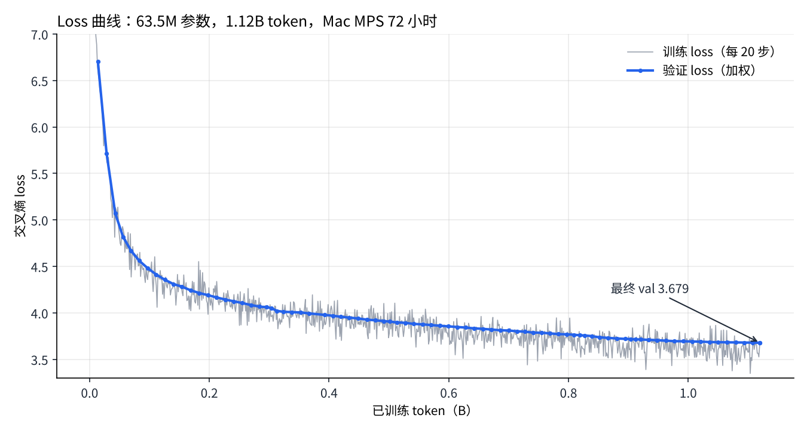
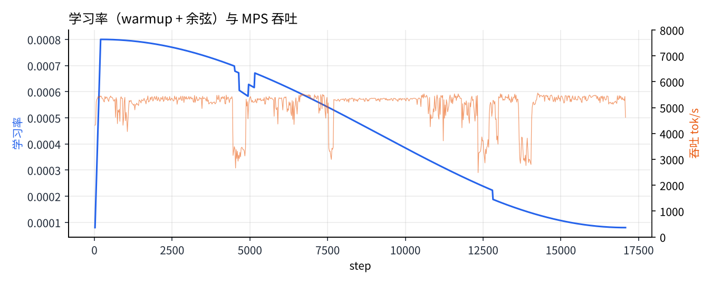
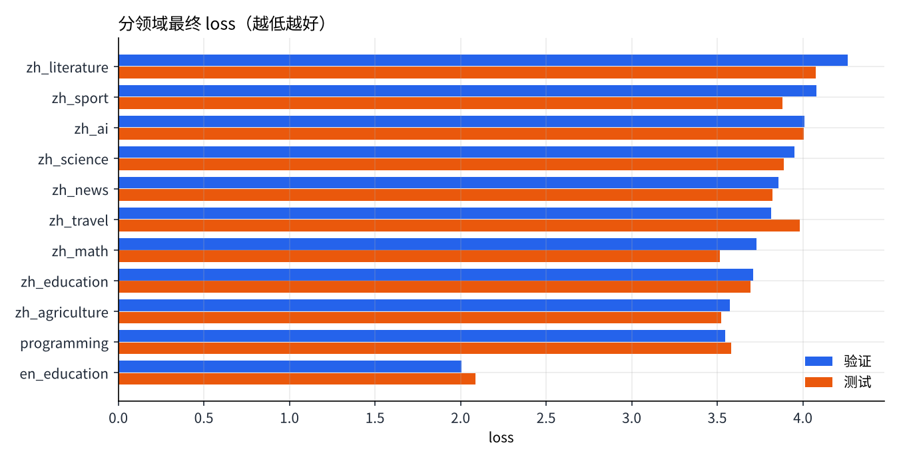

# 在一台 Mac 上用多智能体 loop 从零预训练中文小语言模型

本仓库记录了一次完整的**从零预训练**实验：在 Apple Silicon Mac 的 GPU（MPS）上，用 72 小时把一个 **63.5M 参数**的 Decoder-only 语言模型在 **1.12B token** 的中英文行业语料上训练完成。

整个流程（数据下载与清洗 → 从头训练 32k BBPE 分词器 → 模型结构自检与吞吐基准 → 训练 → 评估）由一个**五智能体协作的 loop** 自动执行：每个智能体负责一类决策，所有决策和理由都记录在消息总线里，可断点恢复、出错自动重启。

| 项目 | 结果 |
|---|---|
| 模型 | Decoder-only Transformer，63.5M 参数（d=640，10 层，GQA 10/2 头，SwiGLU，RoPE，Pre-RMSNorm，tied embedding） |
| 数据 | BAAI/IndustryCorpus（ModelScope，固定 revision）11 个领域，清洗去重后 9.6 亿字符 → 5.6 亿唯一 token |
| 分词器 | 从头训练的 32,000 词表字节级 BPE（中文约 1.6 字/token） |
| 训练 | 17,091 步 × 65,536 token = **1.12B token**（约 2 轮），bf16，Mac MPS，约 5,000 tok/s |
| 验证 loss | **3.679**（困惑度 39.6） |
| 测试 loss | **3.635** |
| 耗时 | 72 小时预算内完成（数据 + 分词器约 3 小时，训练约 63 小时） |



> **2026-11 更新**：第二阶段换到单卡 A800，训练了 0.48B 参数、25B token 的 v1 基座模型，并在它上面做了分词器对照、噪声与学习率消融、数据工程统计、继续预训练（路线 A）和机理分析。详见 [A800 阶段](#a800-阶段)。

| | Mac 阶段 | A800 阶段（v1） |
|---|---|---|
| 硬件 | Apple Silicon（MPS） | 单卡 A800 80GB（AutoDL） |
| 模型 | 63.5M（d640 × 10 层） | 0.48B（d1024 × 40 层，GQA 16/4） |
| 数据 | IndustryCorpus 11 个领域，0.56B 唯一 token | 中文网页、中英教育类、合成教材、代码、数学 7 个来源，约 12.9B 唯一 token |
| 训练 | 1.12B token，余弦调度，约 5k tok/s | 25B token，WSD 调度，约 47k tok/s（MFU 约 51%） |
| 验证 / 测试 loss | 3.679 / 3.635 | 2.2879 / 2.2611 |
| 智能体 | 5 个 | 6 个（加了结果分析智能体） |

两个阶段的数据和分词器都不同，loss 不能直接比。

---

## 目录

- [快速开始](#快速开始)
- [模型结构](#模型结构)
- [数据与分词器](#数据与分词器)
- [五智能体 loop 的设计](#五智能体-loop-的设计)
- [本次运行中智能体做了哪些决策](#本次运行中智能体做了哪些决策)
- [评估结果](#评估结果)
- [经验与局限](#经验与局限)
- [A800 阶段](#a800-阶段)
- [仓库结构](#仓库结构)

---

## 快速开始

### 环境

```bash
python -m venv .venv && source .venv/bin/activate
pip install -r requirements.txt          # torch>=2.3, numpy
```

Apple Silicon 用 `--device mps`，NVIDIA GPU 用 `--device cuda`，也可以 `--device cpu`。

### 用训练好的模型生成

在仓库根目录执行。模型权重（`best.pt`，254MB，内嵌分词器）超过 GitHub 单文件 100MB 的限制，放在本仓库的 **Releases** 页面。下载后放到 `checkpoints/best.pt`：

```bash
python -m decoder_from_scratch.infer \
  --checkpoint checkpoints/best.pt --device mps \
  --prompt "人工智能的发展" --method sample --top-k 40 --top-p 0.9 --temperature 0.8 \
  --max-new-tokens 120 --repetition-penalty 1.2 --no-repeat-ngram-size 4
```

> **提示词请用半角标点**（`,` `.` 而不是 `，` `。`）。训练语料里几乎没有全角逗号和句号，全角标点会把模型带到很少见的 token 上，输出明显变差。
> 小模型贪心解码容易复读，建议用采样并开启 `--repetition-penalty` / `--no-repeat-ngram-size`。

### 复现训练

```bash
# 以下命令都在仓库根目录 LLM_test/ 执行；默认运行目录 decoder_from_scratch/runs/multiagent_pretrain_v1
# macOS 上用 caffeinate 防止睡眠；异常退出 2 分钟后守护脚本自动用最新代码重启
nohup caffeinate -is bash decoder_from_scratch/multiagent/run_loop.sh >/dev/null 2>&1 &

python -m decoder_from_scratch.multiagent.loop status    # 进度 + 最近的智能体消息
python -m decoder_from_scratch.multiagent.loop stop      # 保存后停止（删除 STOP 文件后可续跑）
python -m decoder_from_scratch.multiagent.loop restart   # 改代码后保存并用新代码重启
```

数据会从 ModelScope 下载（12 个 `.jsonl.gz` 文件共约 11.8GB），加上编码后的 token 与检查点，需要约 20GB 磁盘。预算、配比等参数在运行目录的 `config.json` 里修改（见 [`results/multiagent_pretrain_v1/config.json`](../results/multiagent_pretrain_v1/config.json)）。

---

## 模型结构

代码在 [`decoder_from_scratch/model.py`](model.py)，全部手写，只依赖 PyTorch：

| 组件 | 实现 |
|---|---|
| 位置编码 | RoPE（旋转位置编码） |
| 注意力 | GQA：10 个 Query 头共享 2 组 K/V（head_dim 64），`scaled_dot_product_attention`，支持 KV Cache |
| 归一化 | Pre-RMSNorm |
| FFN | SwiGLU（中间层 1728） |
| 输出层 | 与 token embedding 共享权重 |
| 规模 | hidden 640，10 层，上下文 1024，参数 63.5M（其中 embedding 20.5M） |

**规模怎么选的**：结构智能体先对 4 个候选（25M / 39M / 64M / 100M）分别测 fp32 和 bf16 的实际吞吐，再按"训练 token ≈ 20 × 参数量"（Chinchilla 计算最优）在剩余时间内挑最合适的一个：

| 候选 | 参数 | bf16 吞吐（tok/s） | 72h 可训 token | token/参数 |
|---|---|---|---|---|
| xs_d384_l8 | 24.9M | 9,543 | — | — |
| s_d512_l8 | 38.9M | 7,230 | — | — |
| **m_d640_l10** | **63.5M** | **4,878** | **约 1.0B** | **15.9（最接近 20）** |
| l_d768_l12 | 100.1M | 3,370 | — | — |

训练开始前还会做三项自检：因果性（未来 token 不影响当前输出）、KV Cache 与完整前向一致、bf16 下能把小 batch 过拟合到接近 0，在 CPU 和 MPS 上都通过。

---

## 数据与分词器

**来源**：[BAAI/IndustryCorpus](https://www.modelscope.cn/datasets/BAAI/IndustryCorpus)（Apache-2.0，固定 revision `8a03761a`），每个领域取一个文件，配置见 [`decoder_from_scratch/configs/scale_sources_v1.json`](configs/scale_sources_v1.json)。

**清洗**（[`multiagent/cleaning.py`](multiagent/cleaning.py)）：控制字符与空白规范化 → 长度、语言占比、导航/广告/版权行等规则过滤 → 全局精确去重 + 段落级近重复去重 → 按文档哈希划分 train / val / test（每领域各约 300 篇）。

| 领域 | train 文档 | train 字符 |
|---|---|---|
| zh_education | 139,663 | 216.1M |
| zh_science | 101,828 | 128.0M |
| zh_news | 86,792 | 98.1M |
| zh_literature | 63,140 | 98.6M |
| zh_math | 47,612 | 89.3M |
| programming | 46,984 | 93.0M |
| en_education | 14,782 | 77.1M |
| zh_travel | 39,039 | 48.7M |
| zh_agriculture | 30,437 | 38.8M |
| zh_ai | 20,175 | 37.4M |
| zh_sport | 17,219 | 19.5M |

`en_programming` 去重后验证/测试文档不足，被数据智能体隔离、不参与训练。

**分词器**：[`tokenizer_training/`](../tokenizer_training/) 是一个纯 Python 的字节级 BPE 训练工程：按 Unicode 类别预分词（空白 / 字母含汉字 / 数字 / 符号），初始 256 个字节，用"相邻对计数 + 堆 + 倒排索引"增量合并到 32,000 词表，没有 UNK。本次用 1,000 万字符训练，耗时 7 分钟。训练好的分词器在 [`results/multiagent_pretrain_v1/tokenizer/`](../results/multiagent_pretrain_v1/tokenizer/)。

平均每 token 字符数：中文 1.44–1.84，英文 2.28，代码 1.87。

---

## 五智能体 loop 的设计

代码在 [`decoder_from_scratch/multiagent/`](multiagent/)，详细说明见 [`MULTIAGENT_LOOP.md`](MULTIAGENT_LOOP.md)。

```
              ┌──────────── 决策智能体 decision_agent.py ────────────┐
              │ selftest → data_acquire → data_merge → tokenizer →   │
              │ encode → model_select → train ⇄ review → final_eval   │
              └──┬────────────┬──────────────┬─────────────┬─────────┘
          directive│     directive│      directive│    directive│
        ┌─────────▼──┐  ┌──────▼──────┐ ┌──────▼─────┐ ┌─────▼──────┐
        │ 数据清洗    │  │ 结构/算法    │ │ 训练执行    │ │ 测试评估    │
        │ data_agent │  │ architect   │ │ trainer    │ │ evaluator  │
        └────────────┘  └─────────────┘ └────────────┘ └────────────┘
     ─────── 消息总线 events.jsonl（谁→谁、类型、内容、理由）＋ 黑板 state.json ───────
```

| 智能体 | 职责 |
|---|---|
| 决策 | 编排阶段，审核其他智能体的报告，按明确规则做决策（重试/隔离领域、批准训练计划、缩短/延长计划、回滚、调配比、结束），每条决策写明理由 |
| 数据清洗 | 下载、清洗、去重、划分、调用分词器工程训练、多进程编码；训练中可在独立进程补数据 |
| 结构与算法 | 模型自检、候选结构吞吐基准、按计算最优原则选规模 |
| 训练执行与监控 | AdamW（β2=0.95，wd=0.1）、warmup + 余弦、梯度裁剪与累积；按领域权重不放回采样（可精确恢复）；每 45 分钟一段、每 15 分钟检查点；监控 loss / 梯度 / 吞吐 / 非有限值 |
| 测试评估 | 固定验证块的分领域 loss、12 个固定提示的采样/贪心生成与 4-gram 重复率、结束时测试集评估 |

**训练中的决策规则**

1. **稳定性**：连续 3 步非有限 loss，或验证 loss 比最佳高 5% → 回滚到上一个检查点，学习率 × 0.7。
2. **计划调整**：按实测吞吐预测能否在截止前跑完，跑不完就缩短步数，明显富余就延长，余弦终点随之对齐。
3. **防过度重复**：某领域预计重复超过 4 轮 → 在独立进程补数据，补不到就降权。
4. **防遗忘**：某领域验证 loss 连续两次上升而整体在下降 → 该领域权重 × 1.2（上限为初始的 1.5 倍）。

**容错**：每个阶段写回执，中断后从断点继续；守护脚本 [`run_loop.sh`](multiagent/run_loop.sh) 负责异常重启；72 小时截止时间从首次启动起固定，重启不会延长。

---

## 本次运行中智能体做了哪些决策

完整记录在 [`results/multiagent_pretrain_v1/events.jsonl`](../results/multiagent_pretrain_v1/events.jsonl)，可读版在 [`REPORT.md`](../results/multiagent_pretrain_v1/REPORT.md)。几个有代表性的：

| 时间 | 决策 | 理由 |
|---|---|---|
| 10-31 14:48 | 隔离 `en_programming` | 去重后验证/测试文档不足 |
| 10-31 17:43 | 作废第一版基准，重新选型 | v1 基准在同一进程测多个候选，内存抖动导致吞吐失真；改为每个候选在独立子进程测试 |
| 10-31 17:48 | 批准 m_d640_l10，17k 步 | 72 小时内 token/参数最接近 20 |
| 11-01 09:44 起 | 多次缩短/延长计划 | Mac 吞吐受系统负载波动（2,800–5,800 tok/s）；后来改为"近 4 段中位数 + 单次最多 ±8%"避免来回震荡 |
| 11-01 ~ 11-03 | 6 次提高领域权重 | zh_travel、zh_ai、zh_math、zh_agriculture 出现"整体下降而该领域上升"的遗忘信号 |
| 11-03 08:47 | 训练完成 | 17,091 步、1.12B token，验证 3.679，测试 3.635 |



学习率曲线上的几处"跳变"就是计划调整造成的：余弦调度的形状依赖总步数，中途改总步数会让当前学习率突变。这是本设计的一个缺陷，见[经验与局限](#经验与局限)。

---

## 评估结果

**分领域最终 loss**（验证集 / 测试集，每领域约 300 篇未参与训练的文档）：



英文 loss 明显更低，是因为一个英文 token（约 2.3 个字母）携带的信息远少于一个中文 token（约 1.6 个汉字），本来就更容易预测；**不同语言/领域的 loss 不能直接比较**，只能和自己过去的值比。

**生成样例**（top-p 0.9，温度 0.8；⟨ 之后是模型续写）：

| 提示 | 第 212 步（14M token） | 第 17,091 步（1.12B token） |
|---|---|---|
| 光合作用是指绿色植物 | ,为土侧."大会"中公手"覆盖人"中,可以在地铁代利亚因边缘给商业,5G5HProE为王译… | 的光合作用,是指在正常的植物光照条件下,通过光合作用吸收了植物光合作用,使得植物中的有害物质包括有害物质… |
| 长江是中国最长的河流， | 气候,食品,石界能凝聚的,制作了医疗卫生,现短,重暴雨,绿队,助营业… | 长江上游的长江支流是中国最大的人工湖.长江流域面积204平方公里,主要水系由北到南… |
| 在直角三角形中，勾股定理指出（贪心） | — | :直角三角形斜边上的中线等于斜边的一半. 直角三角形斜边上的中线等于斜边的一半. … |

模型学会了中文语法、句式和不同文体的"样子"（百科、教材、新闻），但**事实不可靠**（长江的面积、"人工湖"都是编的），贪心解码下复读严重（4-gram 重复率 0.87）。这符合 6000 万参数、10 亿 token 量级模型的预期：语言能力先于知识能力出现，知识需要更大的模型和多一个数量级的数据。

所有评估记录：[`eval_history.jsonl`](../results/multiagent_pretrain_v1/eval_history.jsonl)（83 次评估），每次评估的全部生成样例在 [`samples/`](../results/multiagent_pretrain_v1/samples/)。

---

## 经验与局限

1. **可调整计划时不要用余弦调度**。余弦学习率依赖总步数，决策智能体中途改步数会造成学习率跳变。后续 A800 上的 0.5B 实验改用 **WSD（Warmup-Stable-Decay）**：衰减开始前学习率恒定，改总步数不影响当前学习率。
2. **基准测试要隔离**。同一进程依次测多个候选会互相影响显存/内存（Mac 统一内存尤其明显），v1 基准因此失真，改为每个候选独立子进程。
3. **计划调整要抗噪声**。Mac 的吞吐受系统负载影响波动很大，按单段吞吐调整会来回震荡；改成"最近 4 段中位数 + 单次最多 ±8%"后稳定。
4. **训练数据的标点会决定推理时的提示写法**。本次使用的 IndustryCorpus 文件里中文逗号、句号几乎都是半角，清洗时也没有统一，模型对全角标点很陌生。后续实验在清洗阶段统一把中文语境下的半角标点转为全角，推理时对提示词做同样的转换。
5. **规模的上限**。63.5M 参数 / 1.12B token 足以学会流畅的语言形式，但学不到可靠的事实，也不能问答。要"各方面都还不错"至少需要 0.5B 参数、20B+ token 和多样化数据（中英文网页、教材、代码、数学），并在之后做指令微调。

---

## A800 阶段

这一阶段的代码在服务器的 `decoder_from_scratch/a800/`（多智能体 loop、路线 A、实验室、机理分析），还没有同步到本仓库；下面记录设计、结果和踩过的坑。所有实验都遵守同一条原则：固定数据、模型和 token 预算，一次只改一个变量，用与分词无关的 bits/字节比较，并用种子噪声判断差异是否真实。

### 1. v1 基座模型：0.48B 参数、25B token

| 项目 | 设置 |
|---|---|
| 结构 | d1024_l40：40 层，hidden 1024，16 个查询头共用 4 组 KV（GQA），SwiGLU（中间层 2816），RoPE，Pre-RMSNorm，输入输出共享词嵌入；483.7M 参数（嵌入约 33M） |
| 分词器 / 上下文 | 自训 32k 字节级 BPE / 1024 |
| 优化 | AdamW（β2 0.95，wd 0.1），梯度裁剪 1.0，每步 524,288 token，峰值学习率 4e-4 |
| 调度 | WSD：warmup 1000 步，恒定，最后 20% 线性衰减到 0.1 倍 |
| 规模 | 47,683 步，25B token，约 52 token/参数；唯一数据约 12.9B，每份数据约过 2 遍（受 50GB 数据盘限制） |

| 来源 | 数据集（ModelScope） | 唯一 token | 权重 | 验证 loss | 测试 loss | bits/字符 |
|---|---|---|---|---|---|---|
| zh_cci3 | BAAI/CCI3-HQ | 3.58B | 0.28 | 3.081 | 3.091 | 2.81 |
| zh_fwedu | Fineweb-Edu-Chinese-V2.1 | 1.79B | 0.14 | 3.072 | 2.826 | 2.66 |
| zh_industry | BAAI/IndustryCorpus | 1.66B | 0.13 | 2.915 | 3.012 | 2.64 |
| en_fwedu | smollm-corpus / fineweb-edu-dedup | 2.37B | 0.18 | 1.651 | 1.613 | 0.97 |
| en_cosmo | smollm-corpus / cosmopedia-v2 | 0.89B | 0.07 | 1.092 | 1.047 | 0.58 |
| code | starcoderdata | 1.53B | 0.12 | 1.101 | 1.133 | 0.59 |
| math | finemath-4plus | 1.03B | 0.08 | 1.382 | 1.363 | 0.90 |
| **加权** | | **12.85B** | | **2.2879** | **2.2611** | |

- **WSD 的衰减段最值钱**：恒定学习率阶段末期每 1B token 验证 loss 只降 0.0065；最后 20% 的衰减段一共降了 0.1148。
- 中文 loss 高主要是分词粒度造成的，按字节折算，中英文的信息量基本持平。
- 吞吐 46,964 tok/s，MFU 0.51；训练全程梯度范数 0.15–0.2，没有尖峰和 NaN。
- 训练结束后自动做的探测：pass@k 显示一元一次方程（pass@16 0.52）、比较大小（0.78）、中英文应用题（0.31 / 0.39）已有足够多"部分答对"的分组，可以直接做 RLVR；三位数加减（pass@16 0.01）要先 SFT。贪心解码 4-gram 重复率 0.65。词嵌入范数能以 AUC 0.997 认出训练中几乎没出现过的 token。
- 第六个智能体"结果分析"：对最近 8 次评估做线性拟合并计算 t 值，判断整体和各来源是 improving / plateau / regressing。第一阶段的"连续两次上升就加权"规则在 A800 上被噪声触发了 30 多次，改成显著性判定后只在真实变差时调配比。

### 2. 分词器对照：v1 vs v2

同一份原文（来自 v1 没用过的文件，含约 3% 合成算术题），同一个 1.25 亿参数模型（d768_l16），只换分词器。v2 用 Qwen2 / GPT-4 风格预切分：前导空格并入单词、数字逐位切开。

| 指标 | v1 | v2 |
|---|---|---|
| 加权 bits/字节（越低越好） | 1.0563 | 1.0629（+0.6%，不显著） |
| 多位数运算平均准确率 | 89.1% | 96.8%（+7.7 个点，显著） |
| 每 token 字节数：中文网页 / 英文教育类 / 代码 / 数学 | 4.46 / 2.45 / 2.37 / 2.21 | 4.68 / 3.80 / 2.84 / 3.14 |
| 四位数加法 / 两位乘两位 | 82.5% / 48% | 100% / 79% |

- **比较分词器要用 bits/字节**，每 token 的 loss 会被压缩率带偏。
- **基础算术首先缺的是数据**：训练数据里加了 3% 合成算术后，用 v1 分词器的小模型两位数加法也是 100%；而 v1 基座（训练数据里没有合成算术）在 "a+b=" 格式下只答对 3.6%。逐位切分数字的优势出现在更难的题上。
- v2 没达到事先定的"运算高 10 个点以上"的标准，路线 A 继续用 v1，v2 留给下一代模型。

### 3. 噪声与学习率：先量出噪声，再谈"更好"

代理模型 d768_l16，同一份数据完整过一遍。

| 组 | 加权 bits/字节 | 与基准之差（√2·σ 的倍数） | 运算准确率 |
|---|---|---|---|
| 学习率 5e-4 | 1.0674 | +3.8（显著变差） | 89.9% |
| 学习率 1e-3（基准，3 个种子） | 1.0543 ± 0.0021 | — | 89.6% ± 0.7% |
| 学习率 2e-3 | 1.0524 | −1.3（不显著） | 87.3% |
| 学习率 4e-3 | 1.0589 | +0.9（不显著） | 85.2% |

- 种子噪声 σ = 0.0021 bits/字节（相对 0.2%）；两组独立训练之差超过 3·√2·σ ≈ 0.0087 才算真实差异。很多看起来像改进的差异都在这个范围内。
- 1e-3 到 2e-3 是一个平台；学习率过大先伤运算这类精确任务，平均 loss 还看不出来。
- 每组还记录了梯度裁剪实际生效的步数占比和每步更新量 / 权重的范数比，用来判断训练是不是在靠裁剪撑着。

### 4. 数据工程：重复、污染与文档长度

用 MinHash（112 个哈希、5-gram、LSH 14 段 × 8 行、相似度 ≥ 0.8）对路线 A 要用的全部文件做跨文件近似去重，并和 v1 的验证 / 测试文档比对。

- **重复率差别很大**：中文 FineWeb-Edu 第 1 段 13.5%、第 2 段 32%（按字符）；行业和数学约 5%；其余来源不超过 1.3%。
- **小样本会低估重复率**：近似重复是成对出现的，中文 FineWeb-Edu 抽 25% 的文件测出 9.5%，全量是 17.2%。
- **评测污染**：v1 中文教育类验证 / 测试文档有 16% 在第 1 段数据里有近似重复，这个来源的验证 loss 在第 1 段期间偏乐观。
- **长上下文能用上的数据有限**：按第 2 段配比，45% 的 token 位于所在文档第 1024 个 token 之后，只有 12% 位于 4096 之后；扩到 4096 时，大部分窗口其实是几篇文档拼在一起。
- 规则：某来源重复率 ≥ 3% 就启用全局去重，与验证 / 测试文档近似重复的一律剔除；剔除后多选文件，token 总量不变。

### 5. 路线 A：在 v1 上继续预训练（进行中）

两段共用一条全局步数轴，学习率在段间连续，整体就是一个 WSD：

| | 第 1 段 | 第 2 段 |
|---|---|---|
| 数据 | 10B token 全新数据（v1 没用过的文件） | 5B token，配比向数学、代码、教育类、合成教材倾斜，去重并剔除评测污染 |
| 上下文 | 1024 | 4096（v1 在 4096 长度下验证 loss 4.42，没见过 1024 以外的位置） |
| 学习率 | 500 步升到 2e-4 后恒定 | 线性退火到 2e-5 |

起点用 v1 的最终权重和优化器状态，评估口径和 v1 完全一样，曲线可以直接接着比。第 2 段末尾做检查点平均。

**恒定学习率下看不出进展。** 学习率重新升高后，第 1 段的验证 loss 在前 0.5B token 升到约 2.33，此后到 2.1B token 基本不动。v1 末尾已经退火，这时直接和 v1 比没有意义。

**退火探针。** 训到某个点时把现场存下来，用 0.5B token 把学习率从 2e-4 线性降到 2e-5，测验证 loss，再恢复现场继续训练。探针期间不写检查点，中途崩溃也不会污染主线。

| 位置 | 探针前（恒定 2e-4） | 探针后 | 与 v1 最终（2.2879）之差 |
|---|---|---|---|
| 新数据 2.10B token | 2.3304 | 2.2941 | +0.006 |

- 差距约 2/3 来自中文行业类（+0.033）；中文网页、英文合成教材、数学已经和 v1 持平或略好。
- 粗略外推：v1 从同样的 2e-4 退火到底降了 0.049，第 2 段 5B token 的完整退火大概也是 0.045–0.055，路线 A 最终约 2.275–2.285，和 v1 大致持平。
- 两点保留：0.5B 的短退火会低估最终效果；验证集来自 v1 的数据分布，新数据分布不同的来源会显得吃亏。
- **第二次探针**（新数据约 4.1B token，做法完全相同）用来回答"多训的第 1 段到底有没有用"：退火后比第一次再低 0.005 以上就继续第 1 段，否则自动提前结束第 1 段、进入第 2 段。两个探针合起来就是一组 WSD 分叉对照。

### 6. 实验室：μP、scaling law、数据、调度、优化器（已就绪，路线 A 之后自动开始）

109 组实验，单卡约 95 小时，全部在 1.25 亿参数级的代理模型上做：

| 块 | 内容 |
|---|---|
| μP | 坐标检查；宽度 128–512 的学习率扫描（SP 对 μP）；把最优学习率搬到宽 768 验证能否迁移 |
| scaling law | 4 个规模 × 3 个 token 预算（最大的规模只做前两个），拟合 L(N, D)，外推到 0.48B 与 v1 实测对照 |
| 数据 | 配比对比、中文教育类质量分档（4–5 分 vs 3–4 分）、重复率高的来源做去重对照 |
| 学习率调度 | WSD（不同冷却形状和长度）、余弦、线性衰减到 0、Schedule-Free；WSD 从主线的里程碑检查点分叉，一条主线得到多个预算 |
| 优化器 | AdamW、Muon、SOAP 各自扫学习率后最优对最优；用 AdamW 的 loss–数据曲线当尺子，把 loss 差换算成"省了多少 token" |

自测结果：μP 坐标检查中 SP 各层激活随宽度的斜率最高 2.4，μP 都在 ±0.18 以内；四种优化器存取后继续训练与不中断完全一致；所有实验数据都按 v1 验证 / 测试文档剔除了评测污染。

### 7. 打开 v1 看一看：机理分析与推理侧实验

只做前向，数据是 v1 的验证集；分析代码算出的加权验证 loss 2.288，与训练时报告的 2.2879 一致。

| 实验 | 发现 |
|---|---|
| Attention sink | 第 0–8 层几乎不看第一个 token；从第 9 层起，平均每个头有 0.3–0.6 的注意力停在第一个 token 上 |
| 超大激活 | 第 8 层的 MLP 在残差流第 89 维写入约 4,600 的值（同层中位数 0.73），落在首 token 和 BOS/EOS 上，一直保持到第 38 层。它和 sink 在同一层出现 |
| 去掉开头 token | 只看最近 256 个 token：后半段 loss +0.67；窗口里保留开头 4 个 token：只 +0.065（StreamingLLM 现象） |
| Logit lens | 预测逐层慢慢成形，与最终输出的一致率到第 29 层才过半；代码第 21 层，中文第 32–33 层 |
| 逐层消融 | 去掉第 0 层 +7.14（MLP 占 6.63）、第 8 层 +0.84（写超大激活的那层），其余每层 +0.02–0.08；一起去掉最不重要的 8 层 +0.35 |
| 逐头消融 | 单个头最多 +0.01，640 个头里 449 个不到 0.001；最重要的 6 个里有 4 个属于下面的照抄电路 |
| Induction head | 前一 token 头在第 7–8 层，induction head 在第 9–16 层。随机序列重复一遍，第二遍 loss 0.37；去掉 2 个 induction head 回到 8.76，随机去掉同样多的头没影响；去掉 16 个，正常文本里长距离上下文的收益减半 |
| 线性探针 | 绝对位置在词嵌入层读不出来（RoPE 只给相对位置），到第 10 层 R² 0.73，之后又逐渐丢掉。两位数加法模型只答对 3.6%，但 "=" 处进位 100% 可读，和的十位 77%、个位 53%：中间量算出了一部分，没用到输出上 |
| 因果追踪（55 条事实） | 主语位置上前段的 MLP（第 0–16 层）读出事实，第 24–28 层的注意力把它搬到最后一个位置，和 ROME 的图景一致 |
| 解码策略 | 贪心解码 4-gram 重复率 0.43（人类原文 0.04），负对数似然 0.47（人类原文 1.97）；同一片段重复 6 遍，模型给各遍的平均概率 0.34 → 0.72 → … → 0.97，自我强化把贪心锁进循环；top-p 0.9 的两项指标最接近人类原文 |
| 量化 | int8 权重无损；int4（每 128 个一组）+0.062；int3 +0.40；int2 失效。v_proj 最敏感（GQA 下每组 KV 被 4 个头共用）；第 8 层 down_proj 的输入里有中位数 66,600 倍的离群值，所以激活 int8 按张量量化 +0.109、按 token 只 +0.017 |

### 8. A800 阶段的工程经验

1. **守护脚本要区分几种退出**：可重试错误自动重启（最多 20 次）；心跳 45 分钟不更新判定卡死；放 `RESTART` 文件 → 当前步存档、以退出码 75 退出、立刻用新代码和新配置重启（改代码不丢进度）；`STOP` 停下不关机；`NO_SHUTDOWN` 禁止结束后关机；`NEXT_ON_DONE.sh` 把下一个任务接在后面。
2. **时间上限按实际训练秒数算，不要按墙钟**。一次 6 天的外部停机后，按墙钟算的上限让 loop 以为超时，直接跳到了最终评估。
3. **检查点**：每 30 分钟和每段结束各存一次，先写临时文件再改名，保留上一份；放系统盘。`/dev/shm` 在实例重启后会清空，只放能重建的东西。断点续训后逐步核对 loss 与中断前完全一致。
4. **云实例余额用完会被直接停机**。这次停机时距上次检查点 8 分钟，开机后用同一条命令从检查点续训，只丢了这 8 分钟；长任务前按每小时价格算好整个计划需要的余额。
5. **别在训练用的 GPU 上顺手跑分析**：两个进程分时共用 GPU，分析跑的那一小时训练每步从 11.2 秒变成约 22 秒。
6. **固定 Python 环境**：误用基础 conda 环境时，里面残留的旧 torch 文件让 `torch.compile` 报错；守护脚本默认指向项目的 venv。
7. **长任务前先冒烟**：冒烟测试发现 RoPE 位置表只建到 2048、测 4096 会报错；续训时学习率重新升高、验证 loss 先上升，发散阈值要从"比最佳高 5%"放宽到 10%，否则会被误判回滚。
8. **测试"续训与不中断一致"要先量 GPU 的不确定性**：同一配置从头重跑两次的差异约 3e-3，续跑与主线的差异约 2e-8，阈值要拿前者做参照。
9. **分词器的细节会影响提示写法**：v1 的预切分把空格切成单独的 token，英文提示末尾要带空格，模型才会直接预测下一个单词；中文会跨词合并（如"国的"）。
10. **Shell 的两个坑**：`pgrep -f 模式` 会匹配到执行它的那个 shell 自己的命令行；`cd 目录 && 命令 &` 会把整个 `&&` 链放进后台子 shell，子 shell 一直占着输出管道，导致调用方（例如 Python 的 `subprocess.run(capture_output=True)`）卡住。启动后台任务用 `cd 目录; setsid nohup 命令 > /dev/null 2>&1 < /dev/null &`。

### 9. 接下来

| 方向 | 做什么 | 状态 |
|---|---|---|
| 路线 A | 第二次退火探针决定第 1 段的长度，然后第 2 段退火、扩到 4096、检查点平均 | 进行中 |
| 实验室 | 第 6 节的 μP、scaling law、数据、调度、优化器 | 路线 A 之后自动开始 |
| 结构消融 | Pre-LN / Post-LN、RMSNorm / LayerNorm、RoPE / ALiBi / NoPE、SwiGLU / GELU、MHA / GQA / MQA、共享 / 不共享嵌入、QK-norm、z-loss、logit soft-cap | 实验室之后 |
| MoE 与合成数据 | 同激活参数下的稠密 vs MoE；用合成人物传记测"每个参数能存多少知识"，用步数可控的数学题测多步推理 | 实验室之后 |
| 机理与推理 | induction head 在训练中何时出现；KV cache 吞吐、投机解码（实验室的小模型当草稿模型）、长上下文检索 | 部分完成（第 7 节） |
| 评测与后训练 | 正式基准（HellaSwag、ARC、C-Eval、CMMLU、GSM8K、HumanEval）；SFT → RLVR | 待定 |

---

## 仓库结构

```
├── README.md                       # 仓库总览
├── requirements.txt                # 本组件依赖（torch、numpy）
├── word2vec_training/              # 另一个组件：Word2Vec
├── decoder_from_scratch/
│   ├── model.py  config.py         # Decoder-only Transformer（RoPE/GQA/RMSNorm/SwiGLU/KV Cache）
│   ├── generation.py               # 采样 / 贪心 / beam search，重复惩罚、n-gram 禁止
│   ├── tokenizer.py  data.py       # 分词器加载（BBPE / 字符级）
│   ├── runtime.py  infer.py        # 加载检查点与命令行推理
│   ├── configs/scale_sources_v1.json   # 数据源（ModelScope 路径、sha256）
│   ├── MULTIAGENT_LOOP.md
│   └── multiagent/                 # 五智能体 loop
│       ├── decision_agent.py  data_agent.py  cleaning.py
│       ├── architect_agent.py  bench_worker.py  trainer_agent.py  eval_agent.py
│       ├── smoke.py  common.py  loop.py  run_loop.sh
├── tokenizer_training/             # 纯 Python 字节级 BPE 训练工程
└── results/
    ├── figures/                    # 本 README 的图
    └── multiagent_pretrain_v1/     # 本次运行的全部记录
        ├── REPORT.md  config.json  state.json
        ├── train_log.jsonl  eval_history.jsonl  events.jsonl
        ├── samples/  tokenizer/  logs/
```

## 许可

代码供学习研究使用。训练数据来自 BAAI/IndustryCorpus（Apache-2.0），使用时请遵守其许可。
