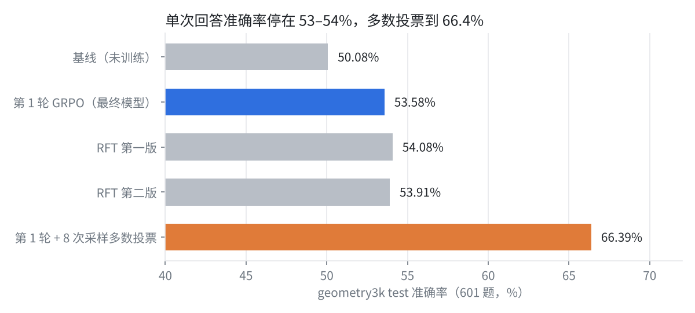
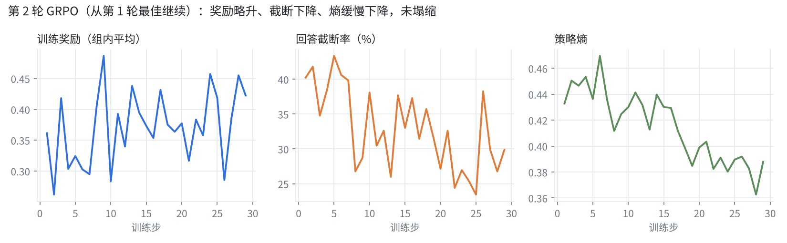
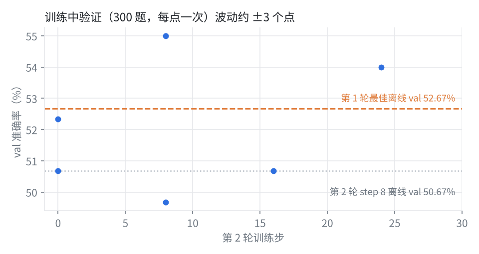

# Qwen3-VL-4B 几何看图解题：多智能体 GRPO、诊断与拒绝采样微调

用 [hiyouga/geometry3k](https://huggingface.co/datasets/hiyouga/geometry3k) 对 **Qwen3-VL-4B-Instruct** 做强化学习（看图解几何题），在 AutoDL 的 2 × A800 80GB 上完成。
训练由**五个智能体协作的 loop** 自动执行（数据清洗 → 基线评估 → 难度筛选 → 训练 → 复核 → 最终评估），所有决策和理由都写进消息总线，可断点恢复、出错自动降级重启、完成后自动关机。

| 方式 | val（300 题） | test（601 题） |
|---|---|---|
| 基线 Qwen3-VL-4B-Instruct（贪心，4096 token） | 50.00% | 50.08% |
| **第 1 轮 GRPO，step 8（最终模型）** | **52.67%** | **53.58%** |
| 第 2 轮 GRPO（从第 1 轮继续） | 50.67% | — |
| 拒绝采样微调 RFT 第一版 / 第二版 | 52.33% / 51.33% | 54.08% / 53.91% |
| **最终模型 + 8 次采样多数投票** | **67.33%** | **66.39%** |

- 第 1 轮相对基线：test 新答对 49 题、原本对的答错 28 题，符号检验 z = 2.39，95% 显著。
- 之后的第 2 轮 GRPO 和两版 RFT 都没能把**单次回答**准确率推过 53–54%；**8 次采样多数投票**不需要训练，比单次高 12.8 个点。
- 用 verl 官方 geo3k 奖励（0.9 × 准确率 + 0.1 × 格式）重算：基线 0.451，最终模型 0.484。



运行的原始记录（自动报告、评估汇总、每步训练指标、RFT 日志、配置）在 [`results/qwen3vl_geo3k_grpo_v1/`](../results/qwen3vl_geo3k_grpo_v1/)。模型权重（8.3 GB）不随仓库发布。

---

## 目录

- [快速开始](#快速开始)
- [实验过程](#实验过程)
- [训练配置与原因](#训练配置与原因)
- [诊断实验](#诊断实验)
- [多数投票与拒绝采样微调](#多数投票与拒绝采样微调)
- [与公开参考曲线的对比](#与公开参考曲线的对比)
- [五个智能体](#五个智能体)
- [遇到的问题与修复](#遇到的问题与修复)
- [经验与下一步](#经验与下一步)
- [训练过程可视化](#训练过程可视化wandb--tensorboard)
- [文件](#文件)

---

## 快速开始

所有命令在 GPU 实例上、本目录下执行。AutoDL 上建议把本目录放到数据盘，例如 `/root/autodl-tmp/qwen3vl_geo3k_grpo`。

```bash
cd qwen3vl_geo3k_grpo
bash setup_env_gpu.sh --install          # 检查 GPU / verl / vllm，补装轻量依赖
export PYTHONPATH=$PWD VLLM_WORKER_MULTIPROC_METHOD=spawn GEO3K_PATCH_CONV3D=1
RUN=/root/autodl-tmp/geo3k_runs/multiagent_v1
```

### 跑完整的多智能体 loop

```bash
nohup bash multiagent/run_loop.sh > /dev/null 2>&1 &
python -m multiagent.loop status         # 进度、各轮结果、最近决策
cat $RUN/REPORT.md                        # 随时更新的报告
python -m multiagent.loop stop           # 停止；再次运行 run_loop.sh 会断点续跑
```

模型自动在 `/root/autodl-tmp` 下查找 Qwen3-VL-4B 权重，找不到时从 ModelScope / HF 镜像下载，也可 `export MODEL_PATH=...`。运行目录的 `config.json` 首次运行时生成，常改：`budget_hours`、`algorithm.max_rounds`、`algorithm.next_preset`、`shutdown_when_done`。

不需要 GPU 的干跑（合成数据 + 模拟 verl，约 10 秒走完全部阶段）和单元测试：

```bash
MA_DRY_RUN=1 bash multiagent/run_loop.sh && cat runs/dryrun/REPORT.md
python -m pytest multiagent/tests -q     # 37 个测试
```

### 测试训练好的模型

| 想知道什么 | 命令 | 耗时（2 × A800） |
|---|---|---|
| 一道题的完整解题过程，并和原始模型对比 | `python infer_geo3k.py --index 12 --compare_with /root/autodl-tmp/qwen3_vl_4b` | 约 2 分钟 |
| 用自己的题图 | `python infer_geo3k.py --image my.png --question "Find x." --answer 12` | 约 1 分钟 |
| 复现 test 53.58% | `python evaluate_geo3k.py --model_path $RUN/rounds/round_1/best_hf --input_file $RUN/data/clean/test.parquet --backend vllm --max_new_tokens 4096 --output_json $RUN/eval/my_test.json` | 约 4 分钟 |
| 多数投票（maj@8，同时给出 mean@8 / pass@8） | 上一行加 `--n_samples 8 --temperature 1.0` | 约 25 分钟 |

`evaluate_geo3k.py` 自动用全部 GPU 做数据并行；`--output_json` 里有每题的输出和对错。诊断用的选项：`--instruction describe`（先描述图再解题）、`--upscale 2`（题图放大）、`--save_samples`（保存全部采样，供 RFT 使用）。提示词、图像处理和判分与训练完全一致：答案必须写在最后一个 `\boxed{}` 里才算分。

### 拒绝采样微调（RFT）

```bash
python evaluate_geo3k.py --model_path $RUN/rounds/round_1/best_hf --input_file $RUN/data/clean/train.parquet \
  --backend vllm --max_new_tokens 4096 --n_samples 4 --temperature 1.0 --save_samples $RUN/rft/train_samples.jsonl
python rft_build.py --samples $RUN/rft/train_samples.jsonl --data $RUN/data/clean/train.parquet \
  --out $RUN/rft/sft.jsonl --balanced --per_item_easy 1 --per_item_mixed 4 --max_chars 16000
torchrun --nproc_per_node 2 sft_qwen3vl.py --model_path $RUN/rounds/round_1/best_hf --data $RUN/rft/sft.jsonl \
  --images $RUN/data/clean/train.parquet --out $RUN/rft/sft_hf --lr 1e-5 --epochs 1 --global_batch 32
```

---

## 实验过程

实际 GPU 训练共两轮，合计约 17 小时；之前约半天花在环境排障、基线评估和数据筛选上。

| 时间 | 阶段 | 发生了什么 |
|---|---|---|
| 11-01 上午 | 环境 | 修复 huggingface-hub 被升级、scipy/numpy 残留文件、vLLM 残留 torch 文件、vLLM CUDA 初始化（改 spawn）；sglang 未安装，自动改用 vLLM |
| 11-01 12:02 | 基线 | 2048 token 下基线 val 43% / test 45.42%，约 44% 的回答被截断 |
| 11-01 15:10 | 基线 | 决策智能体把生成长度提到 4096，基线重测 val 50.00% / test 50.08% |
| 11-01 16:52 | 数据 | 难度筛选：每题采样 8 次，去掉 591 道全对题，训练集剩 1507 题（全错的 596 题保留） |
| 11-01 17:00–21:30 | 第 1 轮 | flash-attn 不可用 → SDPA；vLLM 默认上下文占满显存 → 限制 max_model_len；参考模型 CPU 卸载太慢 → 留在 GPU；bf16 Conv3d 慢约一万倍 → 换成等价线性层，此后每步约 20 分钟 |
| 11-02 00:05–02:38 | 第 1 轮 | step 8 被钉住为最佳；之后续训时 vLLM 唤醒显存不足；第 1 轮以 step 8 结束，val 52.67% / test 53.58%，自动关机 |
| 11-02 08:50–19:25 | 第 2 轮 | 从第 1 轮最佳继续 GRPO 29 步；两次 vLLM 唤醒 OOM，自动降级 L1→L2→L3 续训；step 8 离线 val 50.67%，不如第 1 轮，最终模型仍为第 1 轮 |
| 11-02 15:45 | 磁盘 | 检查点是 18 GB 的 fp32 分片，verl 先写新的再删旧的，step 24 会写满数据盘；临时把原始模型移到系统盘腾空间 |
| 11-02 20:33–21:37 | 诊断 | 四个不训练的实验 + test 多数投票（见下文） |
| 11-02 21:37–22:55 | RFT 第一版 | 训练集每题采样 4 次，取最短正确解 2531 条，全参数微调 79 步 |
| 11-03 09:03–10:25 | RFT 第二版 | 按难度平衡挑 2015 条；第一次因两卡步数不一致死锁，修复后重跑 |



训练中的验证分数波动很大：第 2 轮 step 8 的同一份权重，训练中测出 49.67% 和 55.00%，离线只有 50.67%。300 题的验证集一个标准误约 2.9 个点。



---

## 训练配置与原因

两轮算法参数相同，只有初始模型和显存档位不同。完整配置见 [`results/qwen3vl_geo3k_grpo_v1/plans.json`](../results/qwen3vl_geo3k_grpo_v1/plans.json)。

| 类别 | 参数 | 取值 | 为什么这样设 |
| --- | --- | --- | --- |
| 数据 | 难度筛选 | 每题采样 8 次，去掉全对题，2098 → 1507 题 | GRPO 的优势是组内相对值，一组全对优势为 0，只占算力不产生梯度 |
| 数据 | 每步题数 × 每题采样 | 64 × 8 = 512 条回答 | n=8 时一组里同时有对有错的概率更高、优势估计更稳；2 张卡上一步约 20 分钟 |
| 数据 | 回答最大长度 | 4096 token | 2048 时约 44% 的回答被截断、基线只有 43%；训练和评估用同一长度 |
| 数据 | prompt 最大长度 | 768 token | 实测最长 599 token（含图像 token） |
| 算法 | 优势估计 | GRPO，组内减均值、除标准差 | verl geo3k 官方配方，不需要 critic |
| 算法 | KL | 放进 loss，low_var_kl，系数 0.01 | 弱约束防止为了奖励学出怪输出；实际 KL 接近 0，并未限制学习 |
| 算法 | PPO clip / loss 聚合 | 0.2 / 0.2，token-mean | 标准值；token-mean 让长的错误回答受到更多惩罚 |
| 算法 | mini-batch / PPO epoch / 学习率 | 32 / 1 / 1e-6 常数 | 每步 2 次更新；4–8B 全参数 RL 的常用学习率 |
| 算法 | 熵奖励 | 0 | 实际熵从 0.44 缓慢降到 0.38，没有塌缩 |
| 奖励 | 判分 | 只看最后一个 `\boxed{}`，对 1 错 0；接受单位、度数和 ≥2 位小数的正确近似 | 在这些输出上与 verl 官方判分器 mathruler 几乎一致（53.58% vs 53.74%） |
| 奖励 | 格式奖励 | 0.1 | 沿用官方；Instruct 模型从不输出 `<think>`，这部分从未起作用 |
| 模型 | 注意力 | SDPA，关闭 remove_padding，开梯度检查点 | 镜像里的 flash-attn 不可用 |
| 显存 | rollout | 每卡一个 vLLM（TP=1），显存占比 0.45 | 留一半显存给 FSDP，否则 vLLM 唤醒时 OOM |
| 显存 | 每卡 token 上限 | L1 9422 → L3 4864 | 按词表大小（151936）算 entropy 的 logits 显存；OOM 后自动降档 |
| 检查点 | 保存 / 验证间隔，保留数 | 每 8 步；只留 1 个、不存优化器 | 一个检查点 18 GB，数据盘放不下更多 |

---

## 诊断实验

对象是第 1 轮最佳模型，验证集 300 题，都不需要训练。

| 实验 | 准确率 | 相对基准 | 截断率 | 4096 时截断的 96 题里答对 |
| --- | --- | --- | --- | --- |
| 基准：贪心，4096 token | 52.67% | — | 32.0% | — |
| 先描述图再解题的提示词 | 43.33% | −9.3 | 38.0% | 10 |
| 题图放大 2 倍 | 54.00% | +1.3 | 28.7% | 21 |
| 8192 token | 53.33% | +0.7 | 26.3% | 7（76 题仍被截断） |
| **8 次采样多数投票** | **67.33%** | **+14.7** | 25.6% | — |

- **截断是绕圈，不是空间不够**：生成长度翻倍后，原来截断的 96 题只有 7 题答对。抽查的截断输出都是读错图中数字或位置后推出矛盾，再反复推翻重来。
- **「先描述图」的提示词有害**：回答变长、截断变多。
- **放大题图**只有噪声范围内的提升。
- **模型往往「会做但不稳」**：8 次采样里至少 1 次答对的比例是 77.7%，138 题有对有错。

---

## 多数投票与拒绝采样微调

test 上的多数投票：maj@8 **66.39%**，8 次平均 54.58%，至少 1 次答对 77.2%；601 题里 207 题 8 次全对、137 题全错、257 题有对有错。

既然模型「会做但不稳」，就试了两版拒绝采样微调：用第 1 轮最佳模型在训练集上采样，留下答对且没截断的解法，全参数微调（冻结视觉编码器，学习率 1e-5，1 个 epoch，每次更新 32 条）。

| 版本 | 怎么挑样本 | 样本数 | val | test | test 截断率 | test「有对有错」257 题贪心答对 |
| --- | --- | --- | --- | --- | --- | --- |
| 第 1 轮最佳（对照） | — | — | 52.67% | 53.58% | 29.28% | 113 |
| RFT 第一版 | 每题最短的 2 条正确解 | 2531（中位 1362 字符） | 52.33% | 54.08% | 26.62% | 116 |
| RFT 第二版 | 有对有错的题随机最多 4 条、全对题 1 条 | 2015（中位 2289 字符） | 51.33% | 53.91% | 25.96% | 113 |

两版都只是让回答变短、截断变少，少掉的截断大多变成了答错；单次回答准确率仍在 53–54%。用训练集上自己做对的题去微调，没有迁移到 test 的新题上。

---

## 与公开参考曲线的对比

一张常见的参考曲线（Qwen3-VL 4B / 2B 用 megatron 跑 geo3k GRPO）里，验证奖励从 0.22 在约 30 步内涨到 0.45，然后走平。它的纵轴是 verl 官方奖励（0.9 × mathruler 准确率 + 0.1 × `<think>` 格式分）。用同一把尺子量：

| 模型 | verl 官方奖励 | 准确率 | 格式分 |
| --- | --- | --- | --- |
| 参考 4B，训练前 / 平台期 | 0.22 / 0.45–0.47 | — / 约 40%（若格式分已接近满分） | — |
| 本实验基线（4096 token） | 0.451 | 50.08% | 0 |
| 本实验最终模型 | 0.484 | 53.74% | 0 |

参考曲线前 30 步的陡升主要是学会写 `<think>`、把答案放进 `\boxed{}`、在长度内写完；它的起点偏低（同一模型在本实验 2048 token 下也有 test 45%）。那部分「格式和长度」的提升，本实验靠评估设置（4096 token、只看答案对错）已经拿到了，剩下的只能靠真实的几何能力，所以提升是 +3.5 而不是 +0.23。

---

## 五个智能体

```
                         ┌──────────────── 决策智能体 decision ────────────────┐
                         │ 阶段编排 · 审核报告 · 提前停止 · 预算 · 选模型      │
                         └──┬──────────┬──────────────┬───────────────┬──────┘
           directive/report │          │              │               │   （events.jsonl 消息总线 + state.json 黑板）
                 ┌──────────▼───┐ ┌────▼──────────┐ ┌─▼────────────┐ ┌▼─────────────┐
                 │ 数据清洗 data │ │ 结构/算法     │ │ 训练 trainer │ │ 评估          │
                 │ 获取/清洗/    │ │ architect     │ │ 配置/执行/   │ │ evaluator     │
                 │ 难度过滤      │ │ 模型/verl能力/│ │ 监控/降级/   │ │ 基线/导出/    │
                 │               │ │ 奖励/算法预设 │ │ 钉住检查点   │ │ val/test/对比 │
                 └───────────────┘ └───────────────┘ └──────────────┘ └───────────────┘
```

| 智能体 | 文件 | 职责 |
| --- | --- | --- |
| 决策 | `multiagent/decision_agent.py` | 阶段：`env_check → data_acquire → data_clean → baseline_eval → difficulty_filter → [plan_round → train_round → review_round]×N → final_eval`。截断率超 10% 时加长生成长度；每个验证点审核：新最佳 → 钉住检查点，连续无提升或明显下降 → 提前结束本轮；预算不足一轮 → 直接最终评估；完成后关机 |
| 数据清洗 | `multiagent/data_agent.py` | 坏图、超大图缩放、`<image>` 数量修正、标准答案可判分性自检、选项字母类答案剔除、训练集去重、训练集与 val/test 同题同图的泄漏剔除；实测 prompt 长度；按基线通过率做难度筛选 |
| 结构与算法 | `multiagent/architect_agent.py` | 确认 / 下载模型；`verl --cfg job` 探测已安装 verl 的全部配置键，只使用存在的键；奖励函数自检；算法预设 `grpo` / `dapo_lite`（clip-higher 0.28、去 KL）/ `drgrpo`（去标准差与长度归一） |
| 训练配置执行监控 | `multiagent/trainer_agent.py` | 按 GPU 数量与显存、参数量、数据盘生成配置；verl 独立进程组运行、断点续训；解析日志写 `metrics.jsonl`；崩溃分类（GPU OOM / 内存 OOM / NCCL / 磁盘 / 环境 / 配置）与降级阶梯 L0→L4；停滞检测；新最佳检查点用硬链接钉住 |
| 测试评估 | `multiagent/eval_agent.py` | 基线 val/test；FSDP 检查点合并为 HF；vLLM 两卡数据并行离线评估；逐题对比与符号检验；test 只用于最终对照，所有选择只看 val |

---

## 遇到的问题与修复

| 问题 | 影响 | 修复 |
| --- | --- | --- |
| torch 2.9 + cuDNN 9.10 的 bf16 Conv3d 慢约一万倍 | 视觉编码卡住，GPU 利用率很低 | `geo3k_patches.py` 把 patch embedding 换成等价的 `F.linear`，`sitecustomize.py` 在 verl 进程里自动打补丁 |
| 参考模型卸载到 CPU | ref log-prob 变成 CPU 计算 | 显存够时参考模型留在 GPU |
| flash-attn 的 CUDA 扩展缺失 | 训练启动即报 ImportError | 自动检测，改用 SDPA |
| vLLM 默认上下文 262144 | KV cache 需要 36 GB | `max_model_len` = prompt + 回答长度 |
| `entropy_from_logits` OOM | 更新参数时显存不足 | 按词表大小算每卡 token 上限 |
| vLLM 唤醒时 "CUDA Error: out of memory" | 被当成未知错误原样重试 | 归入显存不足类，降级后续训 |
| 检查点 18 GB，verl 在 keep=1 时先写新的再删旧的 | 第二次保存写满数据盘 | 磁盘计划按峰值估算并提前告警 |
| 卡死检测过严 | 把慢但正常的一步杀掉 | 阈值放宽到 100 分钟 |
| RFT 时样本数为奇数，两卡各自算出的更新步数差 1 | 最后一步集合通信死锁 | 步数按 `len(examples) // world` 统一计算 |
| 只用训练中 300 题的验证分挑检查点 | 挑到的是噪声；非最高分的检查点未经离线评估就被删 | 未修复，见下一节 |

---

## 经验与下一步

1. **先确认评估口径再看提升**。同一模型、同一判分器，生成长度 2048 和 4096 的基线差 5–7 个点；公开曲线里大段提升来自格式和长度。
2. **300 题验证集挑不出检查点**。训练中验证同一权重能差 5 个点。下次应在验证时多次采样取平均，并离线评估最佳和最后两个检查点后再删轮转检查点。
3. **截断大多是看错图后的绕圈**，加长生成长度、换提示词都没用；RFT 能压低截断，但不能把题做对。
4. **单次回答在 53–54% 到顶，多数投票到 66%**。在 4B 上继续用模型自己的输出训练（GRPO、RFT）收益很小；要再往上提，需要模型本身没有的知识：用更强的视觉模型（如 Qwen3-VL-32B / 235B）生成解题过程做蒸馏，或加入更多几何图文数据。DAPO 的超长惩罚和动态采样可以作为下一轮 RL 的选项（`dapo_lite` 预设尚不含这两项）。

---

## 训练过程可视化（wandb / TensorBoard）

`run_loop.sh` 会拉起 `multiagent/wandb_sync.py`：它只读 loop 写下的 `rounds/round_N/metrics.jsonl`、`eval/*.json`、`events.jsonl`，增量推送，不改训练命令，中途开启也不用重启训练。

- **wandb**：实例上运行一次 `wandb login`。每轮一个 run（config 是全部 verl 参数），另有一个 `agents` run 放离线评估表和智能体决策。检查：`python -m multiagent.wandb_sync --check`。
- **TensorBoard**：写到 `/root/tf-logs/geo3k_multiagent`，AutoDL 控制台 → AutoPanel → TensorBoard 可看。
- **连不上 wandb**（部分 AutoDL 区域 `api.wandb.ai` 返回 403）：`python -m multiagent.wandb_sync --export_offline $RUN/wandb_offline` 导出离线 run，拷到能访问 wandb 的电脑后 `wandb sync wandb_offline/wandb/offline-run-*`。

---

## 文件

| 文件 | 作用 |
| --- | --- |
| `geo3k_data.py` | 提示词、verl 记录格式、parquet/jsonl 读写、合成数据 |
| `preprocess_geo3k.py` | geometry3k → `train/val/test` |
| `reward_fn_geo3k.py` | 奖励函数（verl custom reward，返回 `{score, acc, format, boxed}`） |
| `evaluate_geo3k.py` | 离线评估（sglang / vllm / hf / fake 后端，多卡数据并行，maj@k / pass@k，诊断选项） |
| `infer_geo3k.py` | 试用模型：自己的题图或数据集某一题，可与原始模型对比 |
| `rft_build.py` / `sft_qwen3vl.py` | 拒绝采样微调：挑选样本（最短 / 按难度平衡），FSDP 全参数 SFT（冻结视觉编码器） |
| `geo3k_patches.py` / `sitecustomize.py` | Conv3d → 线性层补丁及其自动注入 |
| `run_grpo_qwen3vl_4b_fsdp_sglang_gpu.sh` / `run_all.sh` | 单次手动训练 / 单次流水线 |
| `setup_env_gpu.sh` | 环境检查（`--install` 补装轻量依赖） |
| `multiagent/` | 五个智能体、`loop.py`（run/status/stop/restart）、`run_loop.sh`（守护）、`shutdown_when_done.sh`（完成或异常 30 分钟后关机）、`wandb_sync.py`（旁路监控）、`fake_verl.py`（干跑）、`tests/` |

运行目录（默认 `/root/autodl-tmp/geo3k_runs/multiagent_v1`）：`REPORT.md`、`events.jsonl`（全部指令 / 报告 / 决策及理由）、`state.json`、`data/{converted,clean,filtered}/`、`eval/*.json`（每题结果）、`rounds/round_k/{command.sh,plan.json,metrics.jsonl,logs/,best_hf/}`、`rft/`。
