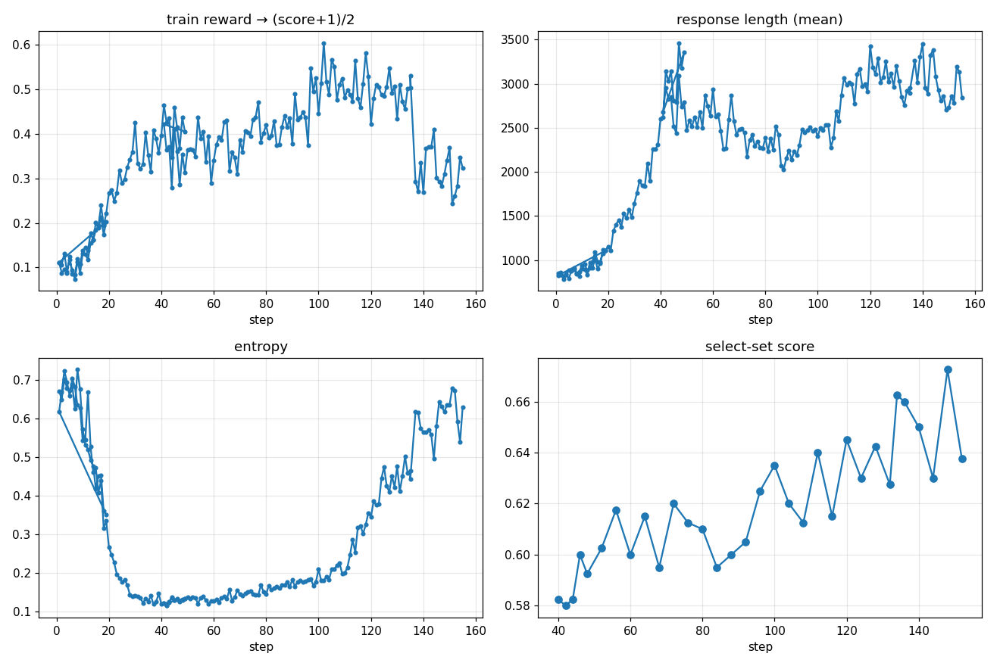

# r1zero：Qwen3-8B-Base R1-Zero 训练总结

最后更新：2026-11-22（项目已收尾）

## 概览

项目已在 11/22 收尾，最终模型是 F 第一阶段第 20 步（四集平均 57.0%，比 R1-Zero 最终模型高 4.3 个百分点），没有达到“可以用”的目标；结论见下一节。

R1-Zero 部分已经结束：第二轮在 step 76 提前结束（平台期），第三轮按事先定好的判定标准逐项检验了四个改动，只有动态采样（B，+1.70）和只训边界题（D，+1.89）带来显著提升，第三轮累计（step 76→156）+4.41 个百分点。最终模型 step 156：MATH-500 87.4%、AMC23 73.8%、AIME24 27.5%、AIME25 22.3%，留出的 AIME 2026 为 21.6%（基座按旧判分是 50.6%、28.0%、4.6%、4.4%）。离“可以用”的目标（MATH-500 ≥ 90%、AIME ≥ 40%）还差得远，所以 11/19 起转向效果线：先蒸馏 SFT（E，11/20 已完成：四集平均比 step 156 高 1.0 个百分点，无显著差异；会做的题更多，但 AIME 约一半回答到 16K 还没写完），再在 SFT 模型上做 RL（F，第一阶段 20 步 11/22 完成：四集平均比 E 高 3.29 个百分点、比 step 156 高 4.3 个百分点，都是显著提升，第一次超过 R1-Zero 最终模型；AIME 正常写完的比例从约 51% 升到 67–72%）。

| 项目 | 内容 |
| --- | --- |
| 目标 | 在 Qwen3-8B-Base 上复现 R1-Zero：不做 SFT，直接用规则奖励做强化学习；11/19 起转向效果线：蒸馏 SFT 后再做 RL |
| 框架 | verl 0.6.1（Megatron 训练 + SGLang 推理），GRPO 加 DAPO 的几项技巧 |
| 硬件 | AutoDL，4 张 A800 80GB PCIe（GPU 之间没有直连），数据盘 50 GB，系统盘 30 GB |
| 训练数据 | DAPO-Math-17k，去重并剔除与评测集重合的题后共 15,939 题；审计又查出 6 道改写过的重复题，第三轮已换成训练集里的其他题 |
| 评测 | MATH-500 全部 500 题；AMC23、AIME24、AIME25 和留出的 AIME 2026（29 题）每题采样 16 次取平均，温度 0.6；判分用修正版 v2 |
| 进度 | R1-Zero 部分 11/19 13:09 结束（第三轮 D 阶段第 156 步）。E 蒸馏 SFT 11/19 13:34 – 11/20 02:50 训完（974 步），04:26 出完整评测结果。F 第一阶段 20 步 11/20 13:45 – 11/22 10:11（此前 11/20 06:19 欠费关机一次，选题采样重跑），11:33 出完整评测结果：对 E 和 step 156 都显著提升。约 12:45 跑完一个推理试验后按用户要求关机；15:20–16:40 又评测了 F 加 presence\_penalty（正确率没有提高，见“结果”），16:47 关机。17:15 用户决定收尾：不跑第二阶段，F 第 20 步为最终模型 |
| 最佳 checkpoint | 最终模型 F 第 20 步在 run/ckpt/f\_sftrl/global\_step\_20/actor/huggingface（数据盘，HF 格式）。R1-Zero 最终模型 step 156（完整评测最好，四个评测集平均比 D 起点高 1.89 个百分点），在 `run/ckpt/r1zero_qwen3_8b_dapo/global_step_156`（数据盘）；系统盘的 `/root/r1zero_best/global_step_148` 是 D 阶段评选分最高的一步，完整评测略低于 156 |
| 运行方式 | 多智能体 loop 自动训练、自动恢复；每个阶段结束后自动做完整评测和配对比较，按事先定好的规则接下一阶段或关机；拿不准时暂停等 Claude，30 分钟没人处理就关机 |

## 结论

项目在 11/22 收尾。最终模型是 F 第一阶段第 20 步，即蒸馏 SFT 之后再做 20 步 RL：MATH-500 89.4%、AMC23 76.6%、AIME24 32.7%、AIME25 29.4%、留出的 AIME 2026 26.3%，四集平均 57.0%。四项都超过了“好”档，但没有达到“可以用”的目标（MATH-500 ≥ 90%、AIME ≥ 40%、AIME 2026 ≥ 30%）；G（可用性）没有做。

**主要发现**

1. 零起点 RL 前期涨得快、后期很慢。基座到第 25 步，四个评测集涨了 10–27 个百分点；第三轮 80 步一共只涨 4.4。检验过的四个改动里，只有动态采样（+1.70）和只训边界题（+1.89）显著有效；每批更新 8 次、学习率翻倍都没有可测的效果。
2. 8B 零起点 RL 的 AIME 停在 22–28%。蒸馏 SFT（6.2 万条 DeepSeek-R1 解答）的总分和它持平，但会做的题更多（AIME24 的 16 次里至少对一次：76.7% 对 60.0%）；短板是写不完，AIME 约一半回答到 16K 还没写完。
3. 在 SFT 模型上做 RL 效果最好。20 步（有效约 10 步）四集平均 +3.29，主要来自写完的比例（AIME 51% → 70%）；这是项目里唯一一次显著超过 R1-Zero 最终模型。
4. 写完不等于做对。推理时加 presence\_penalty 让 E 的 AIME 正确率 +3.0，对 F 却没有用：F 多写完的回答只有 4–8% 是对的。F 剩下的错误主要是做不出来的题，而不是重复循环。
5. 评测要用完整评测加按题配对。每题只采 1 次的验证会误导（F 第 20 步低估约 2.6 个点）；判定标准都在看结果前定好；判分器本身也要审计（原判分漏判 2.4%）。
6. 时间损失大多来自工程问题。R1-Zero 阶段约 22 小时白白浪费；F 第 1–10 步（约 23.5 小时）受重复样本影响，其中第 1、3 步学习率为 0。问题多出在框架的隐含行为（verl 续训不同步优化器主参数、各推理引擎种子相同、只存权重时学习率调度器从 0 开始）和磁盘、存盘管理上，都没有报错，是靠指标异常发现的。

**为什么收尾**

- 按第一阶段的速度，AIME 每 20 步约 +2 个点。原计划的第二阶段（10 步、约 ¥450）预计四集平均 +0.5 到 +1.5，小于完整评测的误差范围（约 ±1.7），很可能测不出差别；到 AIME 40% 要约 100 步，后面通常越来越慢。
- 公开的 7B 蒸馏模型 AIME24 在 50% 以上，用的是 35 万条以上的 R1 解答和 32K 的生成上限（[OpenR1-Distill-7B](https://huggingface.co/open-r1/OpenR1-Distill-7B)、[DeepSeek-R1](https://arxiv.org/abs/2501.12948)）；本项目的 E 只用了 6.2 万条、上限 16K。基座和评测方式不同，不能直接比，但差距主要在蒸馏数据量和生成长度，不在 RL 步数。
- 要冲“可以用”，下一步应该重做蒸馏：几十万条解答、上限 32K，再接短 RL，粗估 ¥1,500 以上。

## 全过程一览

| 阶段 | 时间 | 做了什么 | 结果 |
| --- | --- | --- | --- |
| R1-Zero 第一轮 | 11/05–11/07 | 基座上直接做 GRPO，回答上限 8K，每步 64 题 × 16 条 | 第 25 步四个评测集涨 10–27 个百分点；第 19 步崩溃从头重训，第 49 步到时长上限 |
| 第二轮 | 11/15–11/17 | 从 step 40 续训，加超长软惩罚，每 2 步存盘 | step 46 → 76 +2.08（显著）后进入平台期，step 76 提前结束 |
| 第三轮 A | 11/17 | 每批更新 8 次 | −0.32，无显著差异 |
| 第三轮 B | 11/17–11/18 | 加动态采样 | +1.70，显著 |
| 第三轮 C | 11/18 | 学习率 2e-6 | +1.15，无显著差异 |
| 第三轮 D | 11/18–11/19 | 只训边界题 | +1.89，显著；step 156 为 R1-Zero 最终模型 |
| E 蒸馏 SFT | 11/19–11/20 | OpenR1-Math 的 6.2 万条解答，上限 16K，974 步 | 对 step 156 +1.0，无显著差异；AIME 约一半写不完 |
| F 第一阶段 | 11/20–11/22 | 在 E 上做 RL 20 步，上限 16K，1,065 道边界题 | 对 E +3.29、对 step 156 +4.3，都显著 |
| 推理试验 | 11/22 | E、F 生成时加 presence\_penalty | E 的 AIME +3.0；F 没有变化 |
| 收尾 | 11/22 | 不跑 F 第二阶段，导出到 GitHub | 最终模型 F 第 20 步 |

各阶段的细节见下面的时间线、训练配置、结果和问题与修复。

## 时间线

到 11/18 中午，三轮加起来训练了约 75 小时（按每步耗时加总，含验证，不含完整评测），其中约 22 小时白白浪费：第一轮崩溃时没有 checkpoint、到时长上限前没存盘；第二轮权重被重置回基座、清理 checkpoint 时误删了两份、存盘时磁盘写满。后两次出事后机器都自动关机，等人处理又停了约 18 小时。

| 时间 | 事件 |
| --- | --- |
| 11/22 17:15 | 用户决定收尾：不跑 F 第二阶段（预计提升小于评测误差，也到不了 AIME 40%），以 F 第 20 步为最终模型；整理文档并导出到 GitHub |
| 11/22 15:20–16:47 | GPU 开机评测 F 加 presence\_penalty（1.5 / 2.0，完整评测集共 4,064 条，16:40 出结果）：四集平均正确率 −0.6 / +0.2 个百分点，都不显著；AIME 写完的比例 70% → 83–86%，重复循环基本消失。惩罚和 RL 在写完上叠加、在正确率上不叠加。16:47 读完结果后关机 |
| 11/22 14:54 | 无卡模式开机读推理试验结果：E 加 presence\_penalty 1.5，AIME 三套合计正确率 +3.0 个百分点（+0.5 到 +5.8），写完的比例 +13 个点，重复循环几乎消失；0.5 的效果弱很多 |
| 11/22 12:45 左右 | 推理试验（E 加 presence\_penalty 0.5 / 1.5，AIME 三套共 1,424 条）跑完，按用户要求立刻自动关机；试验结果在盘上，下次开机再读 |
| 11/22 11:33 | F 第一阶段完整评测：对 E 四集平均 +3.29 个百分点（95% 区间 +1.63 到 +5.07），对 step 156 +4.3（+2.0 到 +6.7），都是显著提升；AIME 正常写完的比例 51% → 67–72% |
| 11/22 10:11 | F 第一阶段 20 步训完。第 20 步验证（每题 1 次）四集平均 54.4%，和 E 分不出差别；但 AIME 写到 16K 上限的比例从 E 的 49% 降到 37.5%（若和 E 一样，95% 范围是 42.5–55.8%） |
| 11/21 20:25 | 发现第 1–10 步每题 16 个回答只有 4 个不同（4 个推理引擎种子相同，见“问题与修复”）；第 10 步验证后已自然恢复。给每个引擎设不同种子，只对以后的启动生效 |
| 11/21 16:40 | 修正续训学习率：每次重启第一步学习率为 0（第 1、3 步），改为续训时从 lr/3 预热 1 步，只对以后的启动生效 |
| 11/21 16:20 | 第 10 步验证：四集平均 54.5%（E 53.9%），分不出差别 |
| 11/20 21:13 | 从第 2 步存盘重启：每批生成从 32 题改为 64 题（第 1、2 步可用题都不够 32 道，每步都要再生成一整批） |
| 11/20 16:06 | 15:39 第 2 步显存不足，自动重试，第一阶段从第 1 步重来 |
| 11/20 13:45 | F 第一阶段开始。选题采样（2,048 题各 4 次）选出 1,065 道：746 道边界题 + 319 道全错题；冒烟测试卡在 NCCL P2P，设 NCCL\_P2P\_DISABLE=1 后通过 |
| 11/20 07:29 | 充值开机后续跑 F：f/resume\_f.sh（内容和 start\_ef.sh 的第 4–7 步相同）从选题采样重新开始，看门狗重新启动；预计 11:30–12:30 采完 |
| 11/20 06:19 | 账户欠费，AutoDL 自动关机。F 选题采样已跑约 1 小时 53 分（原估 4–5 小时），结果只在全部采完时写出，这部分要重跑；E 的模型、评测结果和 R1-Zero 的 checkpoint 都在盘上（关机 15 天内数据保留） |
| 11/20 04:42 | F 第一阶段开始前改停训规则：原定“截断率连续 2 步 ≥ 20%”是按 R1-Zero（截断率约 1%）定的，E 模型本身截断率就有 20–50%，第 2 步就会误停；改为相对第 1 步的基线（截断率 ≥ max(20%, 基线 + 15 个百分点)，熵 > max(1.0, 1.5 × 基线)，都是连续 2 步） |
| 11/20 04:26 | E 完整评测出结果：四集平均比 step 156 高 1.0 个百分点（95% 区间 −1.2 到 +3.2），无显著差异；AIME 约一半回答到 16K 还没写完。删掉基座权重（数据盘剩 18 GB），F 开始选题采样（2,048 题 × 4 次） |
| 11/20 02:50 | E 训完（974 步，约 13 小时 15 分，验证集 loss 0.0572 → 0.0539），开始完整评测：2,564 条、共 2,400 万 token，用时约 96 分钟（原估 40 分钟，竞赛题回答平均约 12K token） |
| 11/19 13:34 | E 正式训练开始（verl 的 engine 版 SFT trainer，974 步）。启动时修了四个问题：总控脚本的 set -f 让路径通配失效；容器里 NCCL P2P 卡死，改 NCCL\_P2P\_DISABLE=1；融合 CE 核和 torch 后端不兼容，关掉；verl 0.6.1 的 SFT 存盘忽略 save\_contents，冒烟存盘写满数据盘，打补丁只存 bf16 HF 权重 |
| 11/19 13:09 | D 结束：显著提升（四个评测集平均 +1.89 个百分点，95% 区间 +0.17 到 +3.74）；R1-Zero 部分到此结束，按预案不关机，自动开始 E（蒸馏 SFT） |
| 11/18 23:02 | C 结束：无显著差异（+1.15，区间 −0.42 到 +2.75）；自动开始 D：用 step 136 对 2,047 道训练题各采样 8 次，选出 1,055 道边界题（答对 1–5 次的 739 道，加全错的 316 道），学习率回到 1e-6 |
| 11/18 13:08 | C 跑到第 131 步：评选分 0.630–0.645，熵 0.41–0.48，回答平均约 3,100 token；第 128 步按事先定的条件检查，没有触发提前停训 |
| 11/18 04:21 | B 结束：完整评测显著提升（四个评测集平均 +1.70 个百分点，95% 区间 +0.09 到 +3.32）；按预案自动开始 C：B 的配置加学习率 2e-6，训到第 136 步 |
| 11/17 17:18 | A 结束：无显著差异（−0.32，区间 −1.84 到 +1.14）；开始 B：A 的配置加 DAPO 动态采样 |
| 11/17 09:02 | 第二轮在 step 76 提前结束（step 52–76 七次验证都没超过 step 46）；用 v2 完整评测 step 46 和 76 后，10:05 开始第三轮 A：每批数据更新 8 次（原 2 次） |
| 11/16 21:42 | 腾出磁盘后从 step 48 续训：删掉 step 50 残留和残缺的 Qwen3-4B-RA-SFT，基座分片 1 移到系统盘；挑选改用 v2 判分；看门狗宽限改为 30 分钟 |
| 11/16 16:02 | 存 step 50 时数据盘写满，训练中断；20 分钟内没人处理，16:22 自动关机 |
| 11/16 15:50 | 判分器和数据泄露审计完成：原判分漏判 2.4%、没有误判，写了修正版 v2；AMC23 和 MATH-500 各有 3 道题与训练集重复；加入 AIME 2026 留出集 |
| 11/16 14:11 | 从系统盘的 step 46 续训；生成改为 4 个单卡推理引擎，每步从约 39 分钟降到约 24 分钟 |
| 11/16 00:56 | 清理 checkpoint 时把正在写的 step 56 删了一半，又删了 step 54；续训报错被误判成显存不足，连降三档都失败，01:17 自动关机 |
| 11/15 21:25 | 验证改为每 4 步一次；提速改动（SGLang 显存比例 0.70、logprob 批上限 24576）将在第 52 步存盘后自动重启生效 |
| 11/15 21:13 | 第 50 步完成；平均长度降到 2383，截断率约 6%；最佳更新为 step 46（0.600） |
| 11/15 13:25 | 给 verl 打补丁后从 step 40 重新续训；第 42 步指标恢复正常，评选集 0.580 |
| 11/15 12:04 | 第 42–46 步模型被重置回基座（优化器主参数没有同步），这几步作废 |
| 11/15 10:51 | 第二轮从 step 40 续训：每 2 步存盘和验证，加超长软惩罚，用 400 条评选集，由多智能体 loop2 编排 |
| 11/15 10:45 | 实例重启后出现 numpy 2.x 残留文件，已清除；删掉旧项目 GRPO-TCR-Qwen3-4B，腾出 16 GB |
| 11/07 00:04 | 第一轮到达 26 小时上限，停在第 49 步；最新 checkpoint 是 step 40，第 41–49 步未保存 |
| 11/06 10:51 | 第 25 步在完整验证集上：MATH-500 75.2%，AMC23 54.7%，AIME24 14.4%，AIME25 15.0% |
| 11/06 04:03 | 第一轮第二次正式启动：NCCL 超时调到 3600 秒，改为每 10 步存盘 |
| 11/06 03:08 | 第 19 步 NCCL 超时崩溃；当时还没有 checkpoint，只能从头重训（损失约 5.7 小时） |
| 11/05 22:22 | 第一轮正式训练开始（此前给奖励函数加了 sympy 超时保护） |
| 11/05 21:57 | 冒烟测试通过，按显存档位 1 运行 |

## 训练配置

第二轮只改了奖励、存盘和验证策略，算法和超参与第一轮一致。学习率预热改为 3 步，是因为续训时优化器状态要重新初始化。第三轮每个阶段只改一两项、各跑 20 步，再用完整评测判断有没有用（判定标准见“结果”一节）。

| 配置项 | 第一轮（step 0–40） | 第二轮（step 40–76） | 第三轮（step 76 起） |
| --- | --- | --- | --- |
| 算法 | GRPO，组内标准差归一化，无 KL | 同左 | 同左；B 起加 DAPO 动态采样：去掉组内全对或全错的题，不够 64 题再生成一批补齐 |
| 采样 | 每步 64 题 × 每题 16 条，温度 1.0 | 同左 | 同左；D 改为每步 32 题 × 每题 32 条，只训边界题 |
| 最长回答 | 8192 token（提示最长 1024） | 同左 | 同左 |
| 优化 | 学习率 1e-6，预热 10 步，权重衰减 0.1，每步 2 次更新（mini-batch 32） | 预热 3 步 | 每步 8 次更新（mini-batch 8）；C 起学习率 2e-6 |
| 裁剪 | Clip-Higher：下限 0.2，上限 0.28；token 级损失平均 | 同左 | 同左 |
| 奖励 | 答对 +1，答错或截断 -1（math\_dapo 判分，判错时再用 math-verify 兜底） | 另加超长软惩罚：超过 6144 token 后线性扣分，到 8192 扣满 1 分 | 判分换成修正版 v2，超长惩罚不变 |
| 训练数据 | DAPO-Math-17k，15,939 题 | 同左 | 换掉 6 道与评测集重复的题，行数不变；D 只用边界题 |
| 并行 | Megatron TP=2，全量重计算，参数/梯度/优化器全部卸载到 CPU；SGLang TP=2，显存比例 0.45 | 同左；11/16 续训（第 47 步）起改为 4 个单卡 SGLang 引擎，显存比例 0.70 | 同第二轮；C 起记录推理引擎和训练引擎的 logprob 差异 |
| 验证 | 完整验证集（2100 条），每 25 步一次 | 评选集（400 条），每 2 步一次，第 52 步起每 4 步一次 | 评选集每 4 步一次；每个阶段终点做完整评测（含 AIME 2026） |
| 存盘 | 每 10 步，只存模型权重 | 每 2 步，只保留最新一份（数据盘）和最佳一份（系统盘） | 同左；训练前和每次存盘前检查磁盘余量 |

- **验证集**：AIME24、AIME25、AMC23 每题复制 16 份（等价于 avg@16），MATH-500 全部 500 题，温度 0.6。
- **评选集**：MATH-500 随机 200 题，另外三个数据集每题 2 份，共 400 条。分数按样本数加权，只用来挑最佳 checkpoint，噪声约 ±2–3 个百分点。
- **只存模型权重**：数据盘只有 50 GB，放不下约 100 GB 的优化器状态。代价是续训时 Adam 动量和学习率调度器都从头开始。

## 结果

RL 带来了明显提升：基座到第 25 步，四个评测集都提高了 10–27 个百分点，之后提升变慢。第二轮后半段（step 46→76）四个评测集平均又涨了 2.1 个百分点；第三轮里，每批更新 8 次（A）和学习率翻倍（C）都没有可测的效果，动态采样（B）显著提升 1.7 个百分点，只训边界题（D）显著提升 1.9 个百分点，第三轮累计（step 76→156）提升 4.4 个百分点。最终的 step 156 在 AIME 上仍然偏低：AIME24 27.5%、AIME25 22.3%，留出的 AIME 2026 是 21.6%。

完整评测（MATH-500 全部 500 题；AMC23 和各套 AIME 每题采样 16 次取平均；温度 0.6）。step 46 起用修正版 v2 判分，并加了留出的 AIME 2026；基座和第 25 步是旧判分，MATH-500 大约被低估 3–5 个百分点：

| 模型 | MATH-500 | AMC23 | AIME24 | AIME25 | AIME 2026（留出） |
| --- | --- | --- | --- | --- | --- |
| 基座（step 0） | 50.6% | 28.0% | 4.6% | 4.4% | — |
| 第一轮 step 25 | 75.2% | 54.7% | 14.4% | 15.0% | — |
| step 46（第二轮评选最佳） | 84.8% | 62.0% | 20.8% | 17.3% | 15.1% |
| step 76（第二轮终点） | 86.0% | 65.0% | 23.8% | 18.5% | 14.0% |
| step 96（A 终点） | 85.2% | 66.4% | 21.2% | 19.2% | 15.1% |
| step 116（B 终点） | 86.2% | 68.4% | 22.1% | 22.1% | 18.1% |
| step 136（C 终点 / D 起点） | 86.0% | 71.6% | 25.0% | 20.8% | 19.6% |
| step 148（D 评选分最高，有挑选偏差） | 86.6% | 73.0% | 26.7% | 21.9% | 19.8% |
| step 156（D 终点，R1-Zero 最终模型） | 87.4% | 73.8% | 27.5% | 22.3% | 21.6% |

各阶段的效果（阶段终点对起点，按题配对 bootstrap 10,000 次；差值单位是百分点，方括号里是 95% 区间）：

| 阶段 | 改了什么 | 步 | 四个评测集平均 | AIME 2026 | 结论 |
| --- | --- | --- | --- | --- | --- |
| 第二轮后半段（事后比较） | 不改，继续训练 | 46 → 76 | +2.08 \[+0.57, +3.67\] | −1.1 \[−3.2, +0.9\] | 显著提升 |
| A | 每批更新 8 次（原 2 次） | 76 → 96 | −0.32 \[−1.84, +1.14\] | +1.1 \[−0.9, +3.9\] | 无显著差异 |
| B | A 加动态采样 | 96 → 116 | +1.70 \[+0.09, +3.32\] | +3.0 \[+0.2, +6.2\] | 显著提升 |
| C | B 加学习率 2e-6 | 116 → 136 | +1.15 \[−0.42, +2.75\] | +1.5 \[−2.8, +5.8\] | 无显著差异 |
| D | 只训边界题（学习率回到 1e-6，每步 32 题 × 32 条，保留动态采样） | 136 → 156 | +1.89 \[+0.17, +3.74\] | +1.9 \[−1.5, +5.4\] | 显著提升 |
| 第三轮累计（事后比较） | A–D 全部 | 76 → 156 | +4.41 \[+2.57, +6.30\] | +7.5 \[+2.2, +13.8\] | 显著提升 |

判定标准在看结果之前就定好了：主比较是阶段终点对起点（终点固定为阶段的第 20 步，不挑 checkpoint），主指标是 MATH-500、AMC23、AIME24、AIME25 四个评测集等权平均的差值；95% 区间下限大于 0 记为显著提升，上限小于 0 记为显著下降，否则为无显著差异。AIME 2026 单独报告。B 的提升主要来自 AIME25（+2.9）和 AIME 2026（+3.0），MATH-500 只多了 1.0，不显著。D 的提升比较均匀：各评测集 +1.4 到 +2.5，单项都不显著，合起来显著。

动态采样起作用的原因：训练时约 31% 的题组 16 条全对或全错，组内优势为零，不产生梯度。动态采样去掉这些组，再生成一批补齐 64 题，每步有效的题多了约 45%；代价是每步要生成两批，耗时多约 50%。

多数投票和“16 次里至少对一次”（step 96 → step 116）：

| 评测集 | 多数投票 | 16 次里至少对一次 |
| --- | --- | --- |
| AMC23 | 82.5% → 87.5% | 95.0% → 92.5% |
| AIME24 | 30.0% → 36.7% | 43.3% → 56.7% |
| AIME25 | 30.0% → 26.7% | 43.3% → 43.3% |
| AIME 2026 | 20.7% → 24.1% | 34.5% → 44.8% |

动态采样不只是让会做的题更稳，AIME24 和 AIME 2026 也多做出了几道题。但各套 AIME 仍有 43–57% 的题 16 次全错；训练集里同样难的题也拿不到训练信号，这是边界题实验（D）要处理的。D 之后，AIME24 和 AIME 2026 的全错比例降到 40% 和 52%，“16 次里至少对一次”升到 60.0% 和 48.3%（下表），但仍有约一半的 AIME 题 16 次全错。

D 前后的 pass@k（每题 16 次采样的无偏估计）：

| 评测集 | step 136：pass@1 / 4 / 16 | step 156：pass@1 / 4 / 16 | 16 次全错的题 |
| --- | --- | --- | --- |
| AMC23 | 71.6 / 89.9 / 95.0 | 73.8 / 90.5 / 95.0 | 5% → 5% |
| AIME24 | 25.0 / 38.2 / 53.3 | 27.5 / 42.3 / 60.0 | 47% → 40% |
| AIME25 | 20.8 / 31.4 / 46.7 | 22.3 / 33.6 / 46.7 | 53% → 53% |
| AIME 2026 | 19.6 / 32.1 / 44.8 | 21.6 / 33.5 / 48.3 | 55% → 52% |

E（蒸馏 SFT，974 步）完整评测（11/20 04:26，判分和采样设置同上）：四集平均比 R1-Zero step 156 高 1.0 个百分点（95% 区间 −1.2 到 +3.2），按事先定的标准无显著差异；AIME 涨、MATH-500 和 AMC23 略降。

| 评测集 | E | step 156 | 差值（95% 区间） | 写完的比例 | 写完部分的正确率 |
| --- | --- | --- | --- | --- | --- |
| MATH-500 | 86.4% | 87.4% | −1.0（−4.2 到 +2.2） | 92% | 93.9% |
| AMC23 | 70.8% | 73.8% | −3.0（−7.5 到 +1.6） | 82% | 86.1% |
| AIME24 | 31.0% | 27.5% | +3.5（−0.6 到 +7.3） | 50% | 61.6% |
| AIME25 | 26.7% | 22.3% | +4.4（−0.6 到 +10.0） | 51% | 52.0% |
| AIME 2026（留出） | 24.6% | 21.6% | +3.0（−3.9 到 +9.3） | 52% | 47.7% |

E 的主要问题是写不完：AIME 约一半回答到 16K 还没写完，截断的全部算错，其中四成多是同一行反复出现的死循环；没有中文混杂；平均长度 MATH-500 约 4.0K token、AMC23 7.2K、AIME 约 12K。但 E 会做的题明显更多：pass@1/4/16 在 AIME24 是 31.0/53.5/76.7%（step 156 为 27.5/42.3/60.0%），AIME 2026 是 24.6/44.7/62.1%（156 为 21.6/33.5/48.3%）。所以 F 的重点是让模型写完、写短：思考没写完记 −1，超过 12K 开始扣分。

截断的回答里几乎没有正确答案：出现过正确答案的只有 AIME 1–3%、AMC23 0%、MATH-500 5%（明确写出过某个答案的 19–34%，多数是错的）。所以截断基本是“这条路没走通、一直在绕”，不是“做对了停不下来”；只缩短长度会把它们变成短的错答案。F 的空间来自同一题的其他采样能做对（pass@16）：RL 提高走得通的路的概率、减少死循环，预计截断率会先降，准确率的涨幅要看第一阶段评测。

F 第一阶段（20 步，11/20 13:45 – 11/22 10:11）显著超过 E，也显著超过 step 156：四集平均 57.0%，比 E 高 3.29 个百分点（95% 区间 +1.63 到 +5.07），比 step 156 高 4.3 个百分点（+2.0 到 +6.7）。这是项目里第一次按事先定的标准超过 R1-Zero 最终模型。

| 评测集 | step 156 | E | F 第一阶段 | F − E（95% 区间） | F − step 156（95% 区间） | 正常写完 E → F |
| --- | --- | --- | --- | --- | --- | --- |
| MATH-500 | 87.4% | 86.4% | 89.4% | +3.0（+0.4 到 +5.6） | +2.0（−1.0 到 +5.0） | 92.0% → 96.0% |
| AMC23 | 73.8% | 70.8% | 76.6% | +5.8（+2.7 到 +9.1） | +2.8（−1.4 到 +7.5） | 82.2% → 88.1% |
| AIME24 | 27.5% | 31.0% | 32.7% | +1.7（−2.1 到 +6.0） | +5.2（+1.5 到 +9.4） | 50.4% → 66.9% |
| AIME25 | 22.3% | 26.7% | 29.4% | +2.7（−0.8 到 +6.7） | +7.1（+1.2 到 +13.8） | 51.2% → 72.3% |
| AIME 2026（留出） | 21.6% | 24.6% | 26.3% | +1.7（−1.3 到 +5.0） | +4.7（−2.2 到 +11.4） | 51.5% → 70.0% |
| 四集平均 | 52.8% | 53.7% | 57.0% | +3.29（+1.63 到 +5.07） | +4.3（+2.0 到 +6.7） |  |

F 的提升主要来自写完：AIME 同一行反复出现的比例从 21–28% 降到 14–18%，平均长度少约 1K token。留出的 AIME 2026 涨得最少（对 E +1.7，区间跨 0），第二阶段最终没有做。第 1–10 步因为回答重复（见“问题与修复”），第一阶段实际有效的约 10 步。

每步约 104 分钟，是 R1-Zero 第三轮（约 32 分钟）的 3 倍多：回答长 3.7 倍，每张卡同时能生成的条数只有约 1/3。每题只采 1 次的第 20 步验证低估了提升（AMC23 验证 66%，完整评测 77%），以后以完整评测为准。

推理试验：E 生成时加 presence\_penalty 1.5（回答里出现过的 token 统一减分，不训练），AIME 三套合计正确率 27.5% → 30.5%（+3.0，95% 区间 +0.5 到 +5.8），写完 51.1% → 64.0%，重复循环 11.6% → 1.4%；留出的 AIME 2026 +5.2（+0.9 到 +9.7）。惩罚 0.5 的效果弱很多（正确率 +1.6，区间跨 0）。收益集中在 E 有时能做对的题：通过率 25–75% 的 19 题正确率 +9.5；E 从没做对的 33 题写完多了 22 个点，正确率只多 2.3。E 加惩罚后的 AIME 合计（30.5%）和 F 第一阶段（29.5%）差不多，但 F 还在 MATH、AMC 上显著提升；F 多写完的回答里约 11% 是对的，加惩罚多写完的约 23%。

F 加惩罚（11/22 15:20–16:40，完整评测集 4,064 条）：正确率没有提高，只是写完的多了。四集平均在惩罚 1.5 和 2.0 下分别 −0.6 和 +0.2 个百分点，都不显著，MATH-500 和 AMC23 也没有下降。AIME 写完的比例从 69.7% 升到 83.3% / 86.1%，重复循环从 3–5% 降到 1% 左右，回答短 5–8%。

| 对 F 的差值（百分点，95% 区间） | 惩罚 1.5 | 惩罚 2.0 |
| --- | --- | --- |
| 四集平均正确率 | −0.6（−2.5 到 +1.3） | +0.2（−1.8 到 +2.1） |
| MATH-500 | −0.2（−2.5 到 +2.0） | −0.3（−2.5 到 +1.9） |
| AMC23 | −0.6（−5.5 到 +4.1） | −0.3（−5.0 到 +4.2） |
| AIME 三套合计 | +1.1（−1.3 到 +3.7） | +0.7（−1.8 到 +3.3） |
| AIME 2026（留出） | +5.2（+0.6 到 +10.1） | +0.9（−3.2 到 +5.2） |
| AIME 写完的比例 | +13.6（+9.8 到 +17.4） | +16.4（+12.6 到 +20.2） |

惩罚和 RL 在“写完”上能叠加，在正确率上不叠加。惩罚让 E 和 F 的 AIME 写完比例都多了 13–14 个点（双重差值 +0.6，−4.5 到 +5.5）；正确率上 E 多 3.0，F 只多 1.1，双重差值 −1.9（−5.8 到 +1.7）。同样加 1.5 时，F 和 E 的 AIME 三套合计一样（30.6% 对 30.5%）。

原因是 F 多写完的回答大多是错的：只有 4–8% 是对的（E 加惩罚约 23%），写完的回答里正确的比例从 42.3% 降到 35–37%。惩罚 1.5 的增益只在 F 有时能做对的 33 题（通过率 25–75%，+2.3）；F 从没做对的 31 题写完多了 26 个点，正确率不变。1.5 和 2.0 分不出高低（四集平均 +0.8，−1.5 到 +3.2）；单项的显著结果方向不一致（1.5 在 AIME 2026 +5.2，2.0 在 AIME25 −3.5），像是多次比较里的偶然结果。结论：F 不需要推理时加惩罚，它剩下的错误主要是做不出来的题，不是重复循环。

评选集分数（v2 判分，400 条，误差约 ±0.024，只用来挑 checkpoint）：

| 阶段 | 评选分（每 4 步一次） | 阶段内最高 |
| --- | --- | --- |
| 第二轮后半段（step 52–76） | 0.603、0.618、0.600、0.615、0.595、0.620、0.613 | 0.620（step 72） |
| A（step 80–96） | 0.610、0.595、0.600、0.605、0.625 | 0.625（step 96） |
| B（step 100–116） | 0.635、0.620、0.613、0.640、0.615 | 0.640（step 112） |
| C（step 120–136） | 0.645、0.630、0.643、0.628、0.660（另测了第 134 步：0.663） | 0.663（step 134） |
| D（step 140–152） | 0.650、0.630、0.673、0.638 | 0.673（step 148） |

第二轮的评选最佳 step 46 是 0.623。各阶段内的起伏都在噪声范围内：B 期间评选分最高的 step 112，完整评测只比起点高 0.43（不显著），反而不如阶段终点 step 116，所以判断阶段效果一律看完整评测。C、D 也一样：C 评选分最高的 step 134 在 AIME 2026 上比起点低 1.5；D 评选分最高的 step 148 完整评测只比起点高 1.18（不显著），不如终点 step 156（+1.89）。



图中各阶段的变化：加超长惩罚后，截断率从第 42 步的 10.5% 降到第二轮末的约 3%，第三轮在 1% 左右。熵在第二轮稳在 0.12–0.15；第三轮每批更新 8 次后升到 0.17 左右，加动态采样后逐步升到 0.32，C 阶段学习率翻倍后升到 0.41–0.48。熵升高的同时，回答变长，“wait”“let me check”这类反思词从每条 1.5 个增加到 10–12 个，结尾不写“Answer:”、改用 `\boxed` 的比例从 7% 升到约 40%（v2 判分两种格式都认）；重复行的比例稳定在 10–13%，没有出现中英混杂。推理引擎和训练引擎的 logprob 差异一直很小（KL 约 0.0008），不像是熵升高的原因。第一轮里熵在第 33 步就从 0.67 降到了 0.12，Clip-Higher 在这里几乎没起作用（被裁剪的比例只有约 0.05%）。

## 问题与修复

代价最大的是四件事：第一轮崩溃时还没有 checkpoint，只能从头重训；续训时优化器里的 fp32 主参数没有同步，权重被重置回了基座（verl 0.6.1 的 bug，全程没有任何报错）；第二轮清理 checkpoint 时误删了正在写的一份；存盘时磁盘写满。后两件出事后都自动关机，又各停了几个小时才恢复。

| 问题 | 表现 | 原因 | 修复 | 损失 |
| --- | --- | --- | --- | --- |
| 清理时误删 checkpoint | 11/16 00:56 正在写的 step 56 被删掉一半，step 54 也被删；续训时报 “not a distributed checkpoint” | 清理逻辑只保留“已登记的最新一步”，把还没登记、正在写的 step 56 也当成旧的删了；续训报错又被误判成显存不足，连降三档都失败后关机 | 清理前先检查新 checkpoint 是否完整，不完整就保留旧的；checkpoint 损坏单独归类，不再当显存不足处理；从系统盘的 step 46 续训 | 约 6.6 小时（第 47–56 步），另停机约 13 小时 |
| 存盘时磁盘写满 | 11/16 16:02 存 step 50 时报错中断，20 分钟内没人处理，自动关机 | 新旧两份 checkpoint 要同时放在数据盘上（各约 15 GB），加上基座和其他项目，余量不够；之前“磁盘够用”的判断是错的 | 删掉 step 50 残留和残缺的 Qwen3-4B-RA-SFT，基座分片 1 移到系统盘；训练前和每次存盘前检查余量（至少 17 GB）；看门狗宽限改为 30 分钟 | 约 1 小时，另停机约 5 小时 |
| 判分漏判 | 3,200 条验证生成里 76 条（2.4%）答对被判错，MATH-500 被低估 3–5 个百分点 | 答案行带 markdown 或 LaTeX 包装、“Answer:” 后换行写 \\boxed、文字答案、区间和复数格式 | 修正版 reward\_v2，没有引入新的误判；评测 11/16 起、训练第三轮起改用 | 无（各步排名不变） |
| 评测题混进训练集 | AMC23 和 MATH-500 各有 3 道题在训练集里有改写版 | DAPO-Math-17k 收录了这些竞赛题的改写版，原先的去重没查出来 | 第三轮训练集换掉这 6 题；评选分只虚高 0.003–0.006，排名不变；加 AIME 2026 留出集（去掉 1 道与训练集相同的题，剩 29 题） | 无 |
| 无人值守时没人接手 | 用户不在时，Claude 的定时检查没有按时触发，两次出问题都只能等看门狗关机 | 定时检查在用户不在线时不一定能送达 | 机器上的 stage\_watch 自动评测、比较，并接续下一阶段或关机；拿不准的情况暂停等 Claude，看门狗兜底 | 间接造成上面两次停机 |
| 优化器主参数未同步 | 续训后第 42 步起，熵从 0.12 升到 0.60，长度从 2683 降到 828，MATH-500 子集从 81% 降到 43.5% | 只载入权重、不载入优化器时，verl 没有调用 Megatron 的 `reload_model_params()`；第一次 optimizer.step() 就把初始化时的基座权重写回了模型 | 给 verl 打补丁补上这一步（原文件备份为 `.orig`）；作废第 41–46 步，从系统盘的 step 40 恢复；结果分析智能体新增“权重被重置”检测 | 约 2 小时 |
| NCCL 超时 | 第一轮第 19 步崩溃 | 两个推理引擎生成长度不均，先结束的一组等超过了默认的 10 分钟 | 超时调到 3600 秒；改为每 10 步存盘，第二轮又改为每 2 步 | 约 5.7 小时（从头重训） |
| 判分卡死 | 训练前的验证卡住不动 | 模型写出大阶乘或指数塔，sympy 符号比较算不完 | 对可疑输入跳过符号比较；判分放进子进程，2 秒硬超时 | 约 20 分钟 |
| numpy 残留文件 | 实例重启后 verl 无法导入（scipy 报 ufunc 类型错误） | numpy 1.26 的目录里出现了 362 个 numpy 2.x 的文件，疑似是重启后系统盘把 pip 卸载过的文件恢复了 | 删掉不属于任何已安装包的文件 | 约 15 分钟 |
| verl 先删后写 | 第一轮只剩 step 40 一份权重 | verl 在写新 checkpoint 之前就删除旧的，中途崩溃会两头落空 | 关掉 verl 自己的删除，由测试评估智能体在新的写完后再删旧的 | 无 |
| 到时长上限时未存盘 | 第一轮第 41–49 步没有保存 | 每 10 步才存一次，第 49 步时到了 26 小时上限 | 改为每 2 步存盘 | 约 6.5 小时 |
| 磁盘不足 | 数据盘只剩 3.6 GB | 每个 checkpoint 约 16 GB | 删掉旧项目的 checkpoint；最佳放系统盘，数据盘只留最新一份 | 无 |
| SFT 存盘写满数据盘 | 11/19 13:25 E 的冒烟测试存盘写了 22 GB 后报错，数据盘只剩 3 MB | verl 0.6.1 的 engine 版 SFT 建存盘管理器时参数名写成 checkpoint\_contents，配置被忽略，默认存 fp32 模型和优化器分片（8B 约 100 GB） | 在训练入口打补丁把配置传对，只存 bf16 HF 权重（约 16 GB，只留最新一份）；存盘内容含分片就直接报错 | 约 10 分钟 |
| NCCL P2P 卡死 | 11/19 13:12 SFT 冒烟卡在第一个 barrier，没有报错 | torchrun 下每个进程能看到全部 4 张卡，这个容器里 NCCL 走 P2P 会卡住；RL（Ray）下同样会卡，F 冒烟就卡在这里；R1-Zero 没碰到，是因为它的启动环境一开始就设了 NCCL\_P2P\_DISABLE=1 | NCCL\_P2P\_DISABLE=1（用 NCCL 测试确认：默认、关 cuMem、关 IB 都卡，只有关 P2P 正常） | 约 10 分钟 |
| F 停训规则不适合 SFT 模型 | 11/20 04:26 E 评测：AIME 约一半回答到 16K 还没写完（AMC23 18%、MATH-500 8%） | “截断率连续 2 步 ≥ 20% 就停”是按 R1-Zero（截断率约 1%）定的；E 模型本身截断率就高，照原规则第一阶段第 2 步就会误停 | 04:42 在第一阶段开始前改成相对第 1 步的基线：截断率连续 2 步 ≥ max(20%, 基线 + 15 个百分点)，熵连续 2 步 > max(1.0, 1.5 × 基线)；用假数据自测过，原版留在 f/monitor\_f.py.orig | 无（开跑前发现） |
| F 第 1–10 步每题 16 个回答只有 4 个不同 | 11/21 20:25：第 1–10 步优势值的最大、最小值每步都恰好是 ±1.677（16 个回答里每个结果至少出现 4 次时的上限），第 11 步起出现 ±3.75 | verl 在每张卡上用同一个种子初始化 Python 随机数，SGLang 没收到种子时从里面取，4 个推理引擎种子相同；11/20 加的“把每题的回答分散到各引擎”补丁又让 4 个引擎收到完全相同的请求，于是生成完全相同的回答。第 10 步验证给各引擎不同的题，随机状态从此分开 | 给每个引擎设不同种子（20261121 + 1009 × rank，f/patches/fix\_sglang\_seed\_1121.py，原文件备份 .orig\_seed），只对以后的启动生效 | 第 1–10 步（约 23.5 小时）每步只有 128 条不同的回答，相当于每题 4 个样本；生成有 3/4 是重复的，可用题变少、补批变多 |
| F 每次重启第一步学习率为 0 | 11/21：学习率按步是 0、1/3、0、1/3、2/3（× 1e-6），第 6 步才到 1e-6 | Megatron 的学习率调度器状态不在只存权重的存盘里，每次重启都从 0 开始预热 | 续训时预热改为 1 步、从 lr/3 开始（f/make\_command\_f.py，F\_RESUME\_LR=0 可关），只对以后的启动生效 | 第 1、3 步没有更新权重（共约 4.4 小时） |
| F 显存不足，自动重试没有降档 | 11/20 15:39 第 2 步显存不足；11/21 01:40 发现重试仍停在 1 档 | 训练进程在生成期间仍占着已释放但没还回的显存（碎片，重启后前两步最多约 25.6 GiB）；expandable segments 在这台机器上用不了（宿主机内核 4.19 不支持）；make\_command\_f.py 用 max() 合并档位，F\_MIN\_TIER=1 时第一次重试还是 1 档 | SGLang 显存比例用 0.55（1 档）；降档改为在原档位上加 F\_MIN\_TIER；在 verl 里加显存日志和 ipc\_collect（run/patch\_rollout\_mem.py） | 11/20 13:45–16:06 约 2.3 小时（第 1 步重跑） |

## 多智能体系统

训练全程由七个智能体自动完成：决策智能体按阶段调用其余六个，状态和事件都记在共享看板上；另有一个独立的看门狗负责关机。

（结构见 [README](../README.md) 的“多智能体流水线”一节。）

自动恢复规则：显存不足时降一档；崩溃或卡死时从最新 checkpoint 续训，最多 8 次，连续两次没有产生新 checkpoint 就判定无法恢复。结果分析智能体发现梯度连续为 NaN，或权重被重置（熵猛涨、长度骤降）时，会直接停训。

第三轮起，阶段之间按事先定好的规则自动衔接，规则管不到的情况交给 Claude：决策智能体在阶段结束或遇到拿不准的崩溃时写 `run/WAITING_CLAUDE.json` 暂停，看门狗在暂停 30 分钟后仍没人处理就关机。阶段结束时，stage\_watch 自动对终点做完整评测和配对比较，把结论写进 `run/audit/STAGE_*_RESULT.md`，再接下一阶段或关机。结果分析智能体也加了几条停训规则：被裁剪的比例连续 2 步超过 0.2，熵连续 2 步低于中位数的一半或高于 1.0。

## 提速

主要瓶颈是生成阶段的 KV 缓存：使用率经常在 0.98–1.00，同时有 50–75 个请求在排队。可生成阶段 Megatron 已经全部卸载到 CPU，卡上有大量显存闲着。下表是第 41–50 步的耗时拆分，每步合计 1965–2665 秒。

| 环节 | 每步耗时（秒） | 占比 |
| --- | --- | --- |
| 生成回答 | 1157–1653 | 约 60% |
| 训练更新 | 610–770 | 约 29% |
| 重算旧策略 logprob | 194–240 | 约 9% |
| 验证（每 2 步一次） | 738–931 | 摊到每步约 14% |
| 存 checkpoint | 约 15 | 可忽略 |

下面这些改动只影响执行效率，算法和超参都不变，11/16 续训（第 47 步）起全部生效：

1. SGLang 显存比例从 0.45 提到 0.70，KV 缓存大约翻倍。原配置保留为下一档，显存不足时会自动退回。
2. 重算 logprob 的单批 token 上限从 10240 提到 24576，减少微批次数。
3. 验证改为每 4 步一次，存盘仍然每 2 步一次；续训时起点那一步如果已经验证过，就不再重复验证。
4. 生成改成 4 个单卡引擎（TP=1），省掉双卡之间经主机内存的同步。

实测：生成从每步 1,195–1,606 秒降到 376–666 秒，每步平均从 39 分钟降到 24 分钟（第 47–64 步）；第二轮末回答变短，约 21 分钟；第三轮 A 约 19 分钟。动态采样每步要生成两批，B 回到约 29 分钟；C 的回答变长到约 3,100 token，每步约 34 分钟；D 每步 32 题 × 32 条、同样生成两批，平均约 32.5 分钟。会改变训练动态的做法都没有采用：减少每题采样数、缩短最大长度、异步或离策略生成、用推理引擎的 logprob 代替重算。

## 后续计划

R1-Zero 这条线已在 11/19 13:09 收尾（D 结束），随即转向效果线：先蒸馏 SFT（E，11/20 已完成），再 RL（F，第一阶段 11/22 完成，显著超过 E 和 step 156；第二阶段没有做，11/22 收尾），目标是做出可以用的模型。研究线暂缓。

**接下来的阶段**

1. C（已完成）：B 的配置加学习率 2e-6，step 116→136，无显著差异（+1.15，区间 −0.42 到 +2.75），所以 D 用回 1e-6。事先定的提前停训条件（熵 ≥ 0.6、评选分 < 0.59、重复行 ≥ 20%、截断 ≥ 5%、中英混杂）都没有触发。
2. D 边界题（已完成）：用 step 136 对 2,047 道训练题各采样 8 次测通过率，训练集取答对 1–5 次的 739 道和全错的 316 道（全错的封顶 30%），共 1,055 道；每步 32 题 × 每题 32 条，学习率 1e-6，保留动态采样，step 136→156，显著提升（+1.89，区间 +0.17 到 +3.74）。
3. E 蒸馏 SFT（已完成，11/19 13:09 自动开始）：数据是 OpenR1-Math-220k（Apache-2.0，DeepSeek-R1 生成的解答），每题取最短的一条判对、思考完整、正常结束、不含中文且没有大段重复的解答，和 629 道评测题按 13-gram 去重，去掉超过 16K token 的，剩 62,382 条（约 3.26 亿 token，平均 5,225 token）。在 Qwen3-8B-Base 上训 1 轮：学习率 2e-5、余弦衰减，每批 64 条，按 token 动态拼批，FSDP2；每 250 步存一份 bf16 权重（只留最新一份）。11/20 02:50 训完（约 13 小时 15 分，验证集 loss 0.0572 → 0.0539），04:26 出完整评测结果：四集平均比 step 156 高 1.0 个百分点（−1.2 到 +3.2），无显著差异；AIME 约一半回答到 16K 还没写完，写完的部分正确率 48–62%（见“结果”）。
4. F 蒸馏后 RL（第一阶段已完成，第二阶段没有做）：起点是 E 的模型；提示和判分与 SFT、评测一致，只判 \</think> 之后的答案，思考没写完记 −1；回答上限 16K、12K 起线性扣分。选题：E 对 2,048 道训练题各采样 4 次，按 D 的规则选出 1,065 道（746 道边界题 + 319 道全错题）。第一阶段 20 步（11/20 13:45 – 11/22 10:11），每步 32 题 × 16 条，学习率 1e-6，动态采样（第 3 步起每批生成 64 题），每 2 步存盘；停训规则用相对第 1 步的基线，全程没有触发。结果：对 E 四集平均 +3.29（+1.63 到 +5.07），对 step 156 +4.3（+2.0 到 +6.7），都显著（见“结果”）。第二阶段原计划（11/22 决定不做，见“结论”）：设置沿用第 11–20 步，加上种子修复和续训学习率修正，先跑 10 步再做一次完整评测；10 步加评测约 20 小时、4 卡机器约 ¥450。按用户 11/19 17:16 的决定，不先跑训练类对照实验。
5. G 可用性（没有做）：套对话模板，能正常停止、不中英混杂，能用 SGLang 部署。

**“可以用”的标准**：MATH-500 ≥ 90%，AIME24/25 ≥ 40%，AIME 2026 留出集 ≥ 30%，再加上 G 的几项可用性要求。R1-Zero 最终的 step 156 分别是 87.4%、27.5%/22.3%、21.6%。

**原定的第三轮方案（11/15 写，未执行；改成了上面的逐项检验）**

- `stage16k`：从第二轮的最佳 checkpoint 出发，上下文从 8K 扩到 16K，加 DAPO 动态采样（过滤组内全对或全错的题），超长惩罚从 12288 token 开始扣分，再训 100 步。执行方式：`R1Z_STAGE=16k setsid nohup bash run_loop3.sh &`。
- `formal2_dyn`：仍是 8K，只加动态采样。动态采样用的是 verl v0.6.1 官方的 `recipe/dapo` 训练器。
- 风险：16K 的显存档位没有实测过；recipe 训练器在 Ray 工作进程里能否正常导入，要等第一次启动才知道。

**R1-Zero 研究线（4 个阶段，暂缓）**

1. 只评测不训练（1–2 天）：对基座、step 40、最佳、最终这几个模型，在 AIME25 上画 pass@1 到 pass@128 的曲线，并拟合熵和性能的关系。
2. 小模型消融（1–2 周）：用 Qwen3-1.7B-Base 对比真实奖励、随机奖励和只奖励格式，以及 GRPO 与 Dr. GRPO、开关 Clip-Higher 和动态采样；关键结论用 2 个种子确认，再拿一个非 Qwen 的模型复验。
3. 把胜出的配方放到 8B 上确认。
4. 效果线：先用教师模型生成长思维链做 SFT，再做 RL，可选再加在线蒸馏；在相同算力下与零起点 RL 对比。

**效果目标（按本项目设置估计）**

| 档位 | MATH-500 | AMC23 | AIME24 | AIME25 |
| --- | --- | --- | --- | --- |
| 及格 | ≥ 82% | ≥ 60% | ≥ 20% | ≥ 17% |
| 好 | 85%+ | 65–70% | 25–30% | 20–25% |
| 同类设置的上限 | 87%+ | 70%+ | 30–40%（需要 16K 以上上下文） | 25%+ |
| R1-Zero 最终（step 156，v2 判分） | 87.4% | 73.8% | 27.5% | 22.3% |
| E 蒸馏 SFT（974 步，v2 判分） | 86.4% | 70.8% | 31.0% | 26.7% |
| F 第一阶段第 20 步（最终模型，v2 判分） | 89.4% | 76.6% | 32.7% | 29.4% |
| 可以用（效果线目标） | ≥ 90% | — | ≥ 40% | ≥ 40% |

评判以 AIME25 和 AIME 2026 留出集为主，因为 Qwen 基座在 MATH-500 和 AIME24 上有记忆或污染的迹象。企业可用的水平参照官方 Qwen3-8B 的思考模式（AIME24 约 79%），只靠零起点 RL 达不到，需要走效果线。

## 附录：路径、命令与参考

以下路径都在 AutoDL 实例上，项目根目录是 `/root/autodl-tmp/r1zero`。

| 内容 | 位置 |
| --- | --- |
| 智能体代码 | `ma/`（每次改动前的备份在 `ma/round1_backup/`） |
| 第三轮编排 | `ma/loop3.py`、`ma/stage_watch.py`、`start_next_stage.sh`、`watchdog3.sh` |
| 判分 | `ma/reward_v2.py`（修正版）、`ma/rescore.py`（重打分） |
| 分析脚本 | `ma/paired_compare.py`（配对比较）、`ma/passk.py`（多数投票、16 次至少对一次）、`ma/quality.py`（生成质量）、`ma/check_r3.py`（第三轮状态） |
| 共享状态、事件日志 | `run/state.json`（各阶段存档在 `run/state_round3_*.json`）、`run/events.jsonl`、`run/logs/loop.log` |
| 每步指标 | `run/metrics_r1zero_qwen3_8b_dapo.jsonl`（作废的步数在 `*_badrun_20261115.jsonl` 和 `*_rollback_*.jsonl`） |
| 评选分数记录 | `run/select_history.jsonl` |
| 审计与阶段结论 | `run/audit/`（`AUDIT.md`、每个阶段的 `STAGE_*_RESULT.md`） |
| 第三轮数据 | `run/data/train_dapo_r3.parquet`、`test_aime26.parquet`、`profile_r3.parquet`；D 用的 `train_frontier.parquet` |
| 最新 checkpoint | `run/ckpt/r1zero_qwen3_8b_dapo/global_step_N`（数据盘） |
| 最佳 checkpoint | `/root/r1zero_best/global_step_N` + `best.json`（系统盘） |
| 验证样本 | `/root/r1zero_valgen/`（完整评测在 `final_*/` 子目录） |
| 报告 | `run/REPORT.md`（第一轮）、`run/REPORT_round2.md`（第二轮）、`run/REPORT_round3.md`（第三轮，每个阶段结束时更新） |
| verl 补丁 | `.../verl/utils/checkpoint/megatron_checkpoint_manager.py`（原文件 `.orig`） |
| E 蒸馏 SFT 代码 | `sft/`：`prep_openr1.py`（数据准备）、`run_sft.sh`（训练）、`run_engine_sft.py`（训练入口和 verl 补丁）、`eval_e.py` / `run_eval.sh`（评测）、`start_e_resume.sh`（总控） |
| E 数据 | `sft/data/train.parquet`（62,382 条）、`val.parquet`（256 条）、`stats.json` |
| E 存盘和日志 | `/root/autodl-tmp/sft_ckpt/full_engine/global_step_N/huggingface`（bf16，只留最新一份）；`run/logs/sft_full_latest.log`、`run/logs/e_stage.log` |
| E 评测和 F | E 最终模型 /root/autodl-tmp/sft\_ckpt/full\_engine/global\_step\_974/huggingface；评测 sft/eval\_full/（gen\_\*.jsonl、summary.md）、run/audit/STAGE\_E\_RESULT.md；F 代码在 f/（总控 start\_ef.sh、选题 profile\_f.py / select\_frontier\_f.py、训练 run\_f.sh、停训规则 monitor\_f.py、比较 compare\_f.py，第一阶段续跑 resume\_f6.sh，补丁和分析脚本在 f/patches/），日志 run/logs/f\_stage.log；F 第一阶段存盘 run/ckpt/f\_sftrl/global\_step\_20，评测 f/eval\_s20/、run/audit/STAGE\_F1\_RESULT.md；推理试验 f/eval\_reppen.py → f/eval\_reppen\_E/、run/audit/E\_PRESENCE\_PENALTY\_RESULT.md；F 加惩罚评测 f/eval\_pp\_F.py、f/run\_eval\_pp\_F.sh → f/eval\_pp\_F/、run/audit/F\_PRESENCE\_PENALTY\_RESULT.md |
| E 结论 | `sft/eval_full/summary.md`、`run/audit/STAGE_E_RESULT.md`（训完自动生成） |
| GitHub 导出 | `export/`（`bash export/build_export.sh` 生成 `export/r1zero_github_payload.tar.gz`） |
| DAPO 官方 recipe | `third_party/verl_v061/recipe/dapo/` |

常用命令（在项目根目录执行）：

```bash
python -m ma.check_r3                         # 第三轮状态：最近几步指标、评选分、关键事件
tail -f run/logs/loop.log                     # 看各智能体的动态
tail -f run/logs/stage_watch.log              # 阶段结束后的自动评测、比较和接续
touch run/REPAIRING                           # 修复期间暂停自动关机，20 分钟内要重新 touch
bash start_next_stage.sh frontier             # 上一阶段正常结束后手动启动下一阶段（lr2 / lr2dyn / frontier）
python ma/paired_compare.py <评测A> <评测B>     # 两次完整评测的同题配对比较
python ma/quality.py 116 120 124              # 生成质量：中英混杂、重复行、反思词
```

参考文献：

- [DAPO: An Open-Source LLM Reinforcement Learning System at Scale](https://arxiv.org/pdf/2503.14476)
- [Understanding R1-Zero-Like Training: A Critical Perspective](https://huggingface.co/papers/2503.20783)
- [Does RL Really Incentivize Reasoning Capacity Beyond the Base Model?](https://neurips.cc/virtual/2025/loc/san-diego/oral/119945)
- [Spurious Rewards: Rethinking Training Signals in RLVR](https://proceedings.mlr.press/v306/shao26d.html)
- [The Entropy Mechanism of RL for Reasoning LMs](https://www.emergentmind.com/papers/2505.22617)
- [The Art of Scaling RL Compute for LLMs](https://iclr.cc/virtual/2026/poster/10010607)
- [ProRL](https://www.emergentmind.com/papers/2505.24864)
- [Reasoning or Memorization?（数据污染）](https://arxiv.org/pdf/2507.10532)
