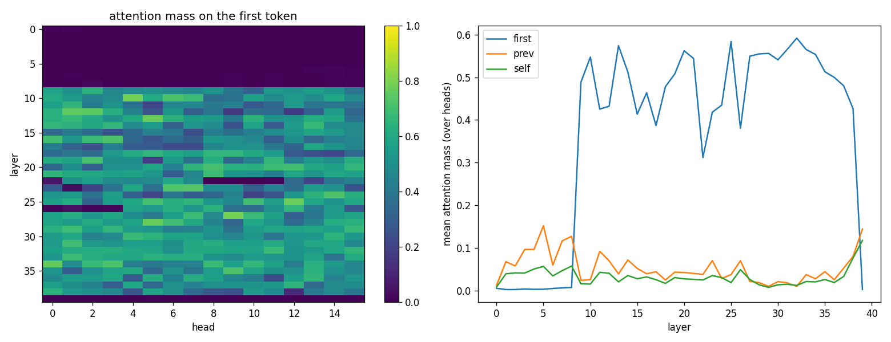
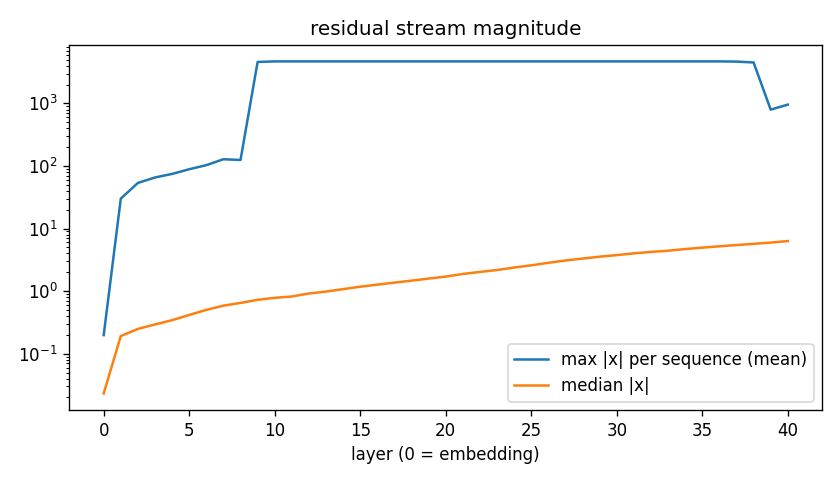
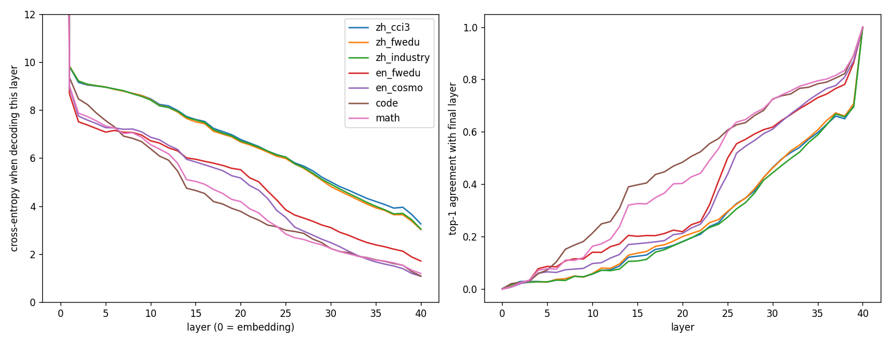
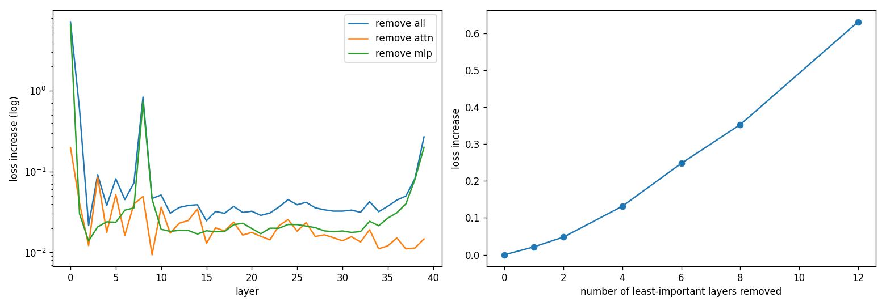
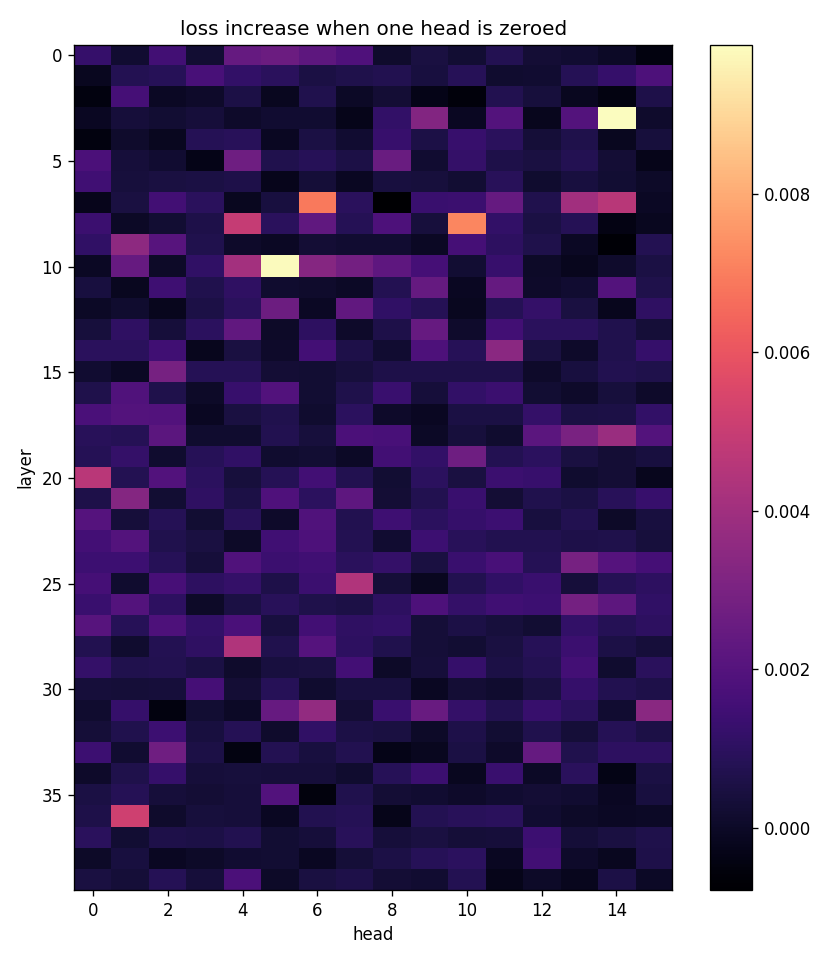
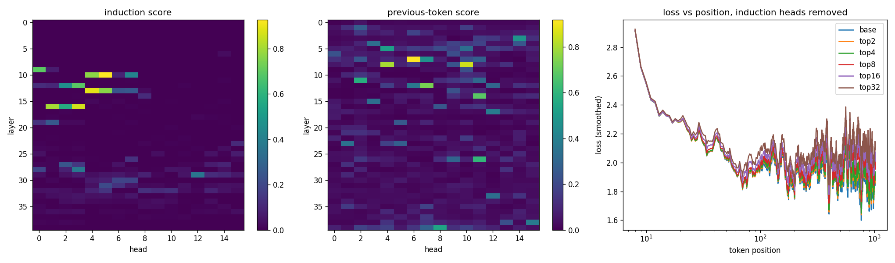
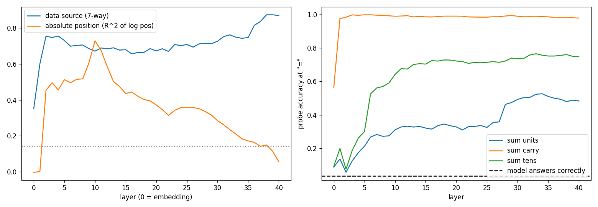
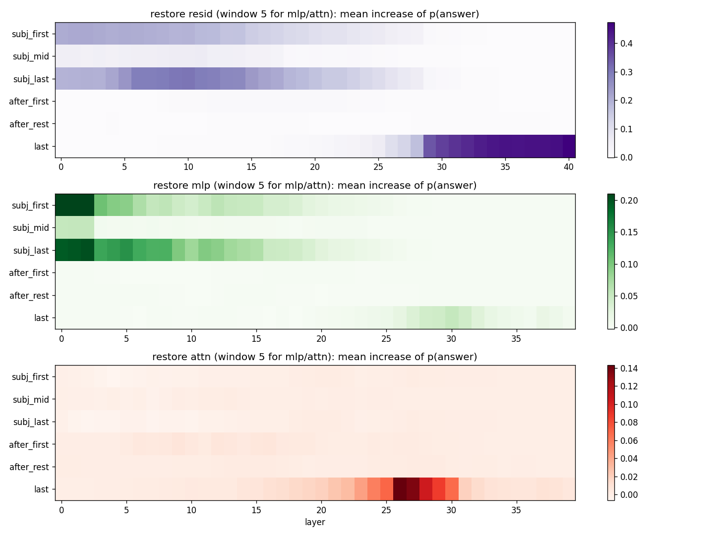
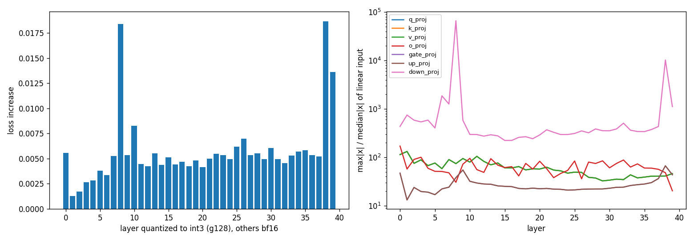

# v1（0.48B，40 层）机理分析与推理侧实验（2026-11-18）

对象是 v1 的 final.pt：隐藏维 1024、40 层、16 个查询头共用 4 组 KV（GQA）、SwiGLU、RoPE、输入输出共享词嵌入，训练了 25B token。数据用 v1 自己的验证集（7 个来源，取法和训练时的验证口径一致）。全部只做前向，和路线 A 的训练共用一张卡。代码在 decoder_from_scratch/a800/mech.py，每项结果的 JSON 和图都在本目录。

基准：bf16 下按评测权重加权的验证 loss 为 2.288，与 v1 训练时报告的 2.2879 一致，说明这套分析代码的模型和数据都对得上。

## 1. Attention sink 与超大激活

- 第 0–8 层几乎不看第一个 token（每层平均注意力不超过 0.01）；从第 9 层起，平均每个头有 0.31–0.59 的注意力落在第一个 token 上，一直持续到第 38 层，最后一层又降到 0.00。
- 同一时刻残差流里出现超大激活：第 9 个状态（第 8 层的输出）起，第 89 维出现约 4603 的值，而同层所有元素绝对值的中位数只有 0.73。它落在序列第一个 token 和 BOS/EOS 这类分隔符上（68% 的序列落在第一个位置），原样保持到第 38 个状态（4518），最后两层把它抵消到约 958。
- 来源：第 8 层 MLP 的 down_proj 输入里，最大值是中位数的 66,600 倍（各层这一比值的中位数是 353）。第 3 节里，去掉第 8 层的 MLP 会让 loss 上升 0.73。
- 去掉开头 token 会怎样（只算第 512–1023 个位置的 loss，按评测权重加权）：

| 注意力范围 | loss | 相比完整注意力 |
|---|---|---|
| 完整的因果注意力 | 2.250 | +0.000 |
| 只看最近 256 个 token | 2.920 | +0.670 |
| 最近 256 个 + 开头 4 个 | 2.315 | +0.065 |
| 完整注意力但屏蔽第一个 token | 2.251 | +0.000 |

解读：sink 是给"这一步不需要从上下文取信息"的头准备的停靠点。超大激活和 sink 在同一层出现，它很可能就是让第一个 token 的 key 对几乎所有 query 都得高分的原因。滑动窗口一旦把开头 token 挤出去，这些头就没处停，只能把注意力摊到无关的 token 上，loss 大涨；把开头 4 个 token 留在窗口里就基本恢复（StreamingLLM 的做法）。直接屏蔽第一个 token 几乎没影响，很可能是第二个 token 接替了 sink：屏蔽后它也只能看到自己，处境和原来的第一个 token 一样。

## 2. Logit lens：每一层"已经想好"了多少

把每一层的残差流直接接最终的 RMSNorm 和输出层解码：

| 层 | 0 | 10 | 20 | 30 | 35 | 38 | 39 | 40（输出） |
|---|---|---|---|---|---|---|---|---|
| 交叉熵 | 83.16 | 7.63 | 5.85 | 3.90 | 3.14 | 2.88 | 2.62 | 2.34 |
| 与最终 top-1 一致率 | 0.00 | 0.10 | 0.25 | 0.55 | 0.67 | 0.72 | 0.78 | 1.00 |

- 第 0 层解码出来的就是输入 token 本身（输入输出共享词嵌入），所以 loss 极高；之后 loss 平稳下降，没有哪一层突然成形；最后一层单独又把 loss 从 2.62 降到 2.34。
- 一致率过半的层：zh_cci3 第 32 层、zh_fwedu 第 32 层、zh_industry 第 33 层、en_fwedu 第 26 层、en_cosmo 第 26 层、code 第 21 层、math 第 24 层。代码和数学最早成形，中文最晚。
- 局限：前面的层表示不一定在输出层的坐标系里，logit lens 会低估它们，训练一组逐层的线性"翻译器"（tuned lens）会更准。

## 3. 逐层消融：每一层有多重要

基准 loss 2.329（每个来源 8 块）。去掉整层 / 只去注意力 / 只去 MLP 后 loss 的增量：

| 层 | 整层 | 只去注意力 | 只去 MLP |
|---|---|---|---|
| 0 | +7.139 | +0.199 | +6.633 |
| 8 | +0.835 | +0.049 | +0.733 |
| 1 | +0.586 | +0.041 | +0.030 |
| 39 | +0.269 | +0.015 | +0.200 |
| 3 | +0.092 | +0.085 | +0.021 |
| 38 | +0.082 | +0.011 | +0.080 |
| 其余 34 层 | +0.022 到 +0.082 | | |

- 第 0 层的 MLP 不可缺：它把词嵌入加工成后面各层能用的表示，相当于"扩展的词嵌入"。
- 第 8 层的 MLP 正是写入超大激活的那一层（down_proj 输入的离群值也在这里），只去掉它 loss 就涨 0.73，比相邻各层大一个数量级。
- 累计剪层（按单层增量从小到大一起去掉）：1 层 +0.022，2 层 +0.048，4 层 +0.132，6 层 +0.248，8 层 +0.353，12 层 +0.632。这个模型没有可以白送的层。

## 4. 逐头消融：每个注意力头有多重要

每次把一个头的输出置零（每个来源 2 块），基准 loss 2.369。640 个头里，增量超过 0.01 的有 0 个，超过 0.005 的有 5 个，449 个不到 0.001。最重要的 10 个：

| 层 | 头 | 增量 | induction 分数 | 前一 token 分数 | 落在首 token 的注意力 |
|---|---|---|---|---|---|
| 3 | 14 | +0.010 | 0.00 | 0.48 | 0.00 |
| 10 | 5 | +0.010 | 0.93 | 0.00 | 0.61 |
| 8 | 10 | +0.007 | 0.00 | 0.85 | 0.00 |
| 7 | 6 | +0.007 | 0.00 | 0.92 | 0.00 |
| 36 | 1 | +0.005 | 0.03 | 0.02 | 0.55 |
| 8 | 4 | +0.005 | 0.00 | 0.80 | 0.00 |
| 20 | 0 | +0.005 | 0.00 | 0.05 | 0.34 |
| 7 | 14 | +0.005 | 0.00 | 0.00 | 0.01 |
| 25 | 7 | +0.004 | 0.00 | 0.01 | 0.65 |
| 28 | 4 | +0.004 | 0.00 | 0.01 | 0.58 |

- induction 分数最高的 8 个头在这张重要性排名里的位置：L10H5 第 2、L13H4 第 41、L16H3 第 557、L16H1 第 68、L10H4 第 11、L13H5 第 553、L9H0 第 169、L12H3 第 334（共 640 个）。
- 单个头几乎都可有可无，这和第 3 节里一整层（16 个头加 MLP）+0.02–0.05 的代价对照来看，说明头之间有大量冗余。排在最前面的 6 个头里有 4 个属于第 5 节的照抄电路：前一 token 头 L7H6、L8H10、L8H4 和 induction head L10H5。
- 头的重要性和"落在首 token 的注意力"几乎无关（相关系数 -0.02）：L10H5 有 61% 的注意力停在 sink 上，仍然排第 2。停在 sink 上只说明它在多数位置不需要取信息，不说明它没用。

## 5. Induction head 与上下文学习

- 把一段 256 个随机 token 的序列重复一遍：第一遍的 loss 是 12.26（比均匀乱猜的 10.37 还高），第二遍降到 0.37，模型几乎能逐字照抄。
- induction 分数（第二遍里，每个位置把注意力放在"它上一次出现之后的那个 token"上的比例）最高的头：L10H5 0.93、L13H4 0.89、L16H3 0.86、L16H1 0.80、L10H4 0.77、L13H5 0.76、L9H0 0.69、L12H3 0.69，集中在第 9–16 层。
- 前一 token 头（注意力放在紧挨着的前一个 token 上）最高的是：L7H6 0.92、L8H10 0.85、L8H4 0.80、L12H7 0.73、L14H11 0.68，主要在第 7–8 层，正好在 induction head 之前：前一个头先把"我前面是什么"写进每个位置，induction head 再拿当前 token 去找"前面是它"的位置，复制它后面的 token。
- 高分的 induction head 经常成组出现在同一组 KV 里（如 L10H4/H5、L13H4/H5、L16H1/H2/H3）。这符合 GQA 的结构：同组的头共用 key，"前一个 token 是什么"只要写进这组 key，组内几个头都能用。

| 去掉的头 | 第二遍 loss | 验证 loss | 上下文学习分数 |
|---|---|---|---|
| 不去掉 | 0.37 | 2.329 | -0.190 |
| induction 分数最高的 2 个 | 8.76 | 2.346 | -0.172 |
| 随机 2 个（3 次平均） | 0.37 | 2.330 | -0.191 |
| induction 分数最高的 4 个 | 9.13 | 2.357 | -0.166 |
| 随机 4 个（3 次平均） | 0.41 | 2.335 | -0.194 |
| induction 分数最高的 8 个 | 12.06 | 2.394 | -0.133 |
| 随机 8 个（3 次平均） | 0.39 | 2.340 | -0.186 |
| induction 分数最高的 16 个 | 12.25 | 2.427 | -0.095 |
| 随机 16 个（3 次平均） | 0.56 | 2.343 | -0.190 |
| induction 分数最高的 32 个 | 12.29 | 2.469 | -0.069 |
| 随机 32 个（3 次平均） | 0.41 | 2.359 | -0.183 |

上下文学习分数 = 文档里第 480–520 个位置的平均 loss 减去第 40–60 个位置的，越负说明后文从前文得到的帮助越大。
只去掉 2 个 induction head，第二遍就从 0.37 回到 8.76，几乎完全不会照抄；随机去掉同样多的头没有影响。在正常文本上，去掉 16 个 induction head 后，长距离带来的收益从 0.190 缩小到 0.095，说明上下文学习有相当一部分就是这套"查找并复制"的电路。

## 6. 线性探针：残差流里能读出什么

- 数据来源（7 类，随机猜是 0.14）：第 0 层 0.35，第 2 层 0.75，最后一层 0.87。区分三类中文网页要靠上下文，越往后越准。
- 绝对位置（log 位置的 R²）：词嵌入层 -0.00（RoPE 本身只给相对位置），第 10 层最高 0.73，之后逐层下降到最后一层 0.06。模型自己推出了"我在第几个位置"（很可能借助 sink：落在首 token 上的注意力随位置变化），用完又逐渐丢掉。
- 两位数加法（三个示例之后问 "a+b="）：模型只答对 3.6%。但在 "=" 处，进位从第 1 层起就几乎完全可读（1.00），和的十位最高 0.77，个位最高 0.53（随机都是 0.10）。中间量一部分已经算出来了，但没有可靠地用到输出上。v1 基座的训练数据里没有合成算术题；tokenizer 对照里加了 3% 合成算术后，用 v1 分词器的 1.25 亿参数模型两位数加法也是 100%，所以这里主要缺的是数据；逐位切分数字（v2）的优势出现在更难的题上（四位数加法 82.5% → 100%，两位乘两位 48% → 79%）。

## 7. 知识存在哪：因果追踪

- 用了 55 条模型答对的事实（中英文的首都、作者、地标、人物等）。给主语的词嵌入加噪声（噪声标准差是词嵌入标准差的 3 倍）后，答案概率从平均 0.50 降到 0.029；再逐层、逐位置把干净的激活恢复回去，看概率回升多少（下面都按"干净 − 加噪"归一化）。
- 残差流：在主语的最后一个 token 上恢复，第 0–16 层都能找回 45%–67%（第 10 层最高），第 28 层后降到 13% 以下；在最后一个 token 上恢复，第 24 层起才开始有用（第 28 层 36%，第 32 层 85%）。信息在第 24–32 层从主语位置搬到了最后位置。
- MLP（一次恢复相邻 5 层）：主语 token 上越靠前作用越大，第 0–2 层约 46%，第 8 层 24%，第 16 层 11%。
- 注意力（一次恢复相邻 5 层）：在最后一个 token 上第 26 层附近最大（30%），正是"搬运"发生的地方；在主语位置上几乎不起作用。
- 和 ROME 的图景一致：前中段的 MLP 在主语位置上把事实"读出来"，后段的注意力把它搬到要预测的位置。不同的是这里起作用的 MLP 更靠前（第 0–16 层）。

## 8. 解码策略与复读

140 个文档开头（7 个来源各约 20 个），给前 48 个 token，续写 128 个。困惑度一栏是模型自己给续写文本的平均负对数似然；人类原文的值是 1.97，越接近它越像正常文本。

| 解码方式 | 4-gram 重复率 | 不同二元组占比 | 负对数似然 | 主动结束的比例 |
|---|---|---|---|---|
| 人类原文 | 0.041 | | 1.97 | |
| greedy | 0.428 | 0.31 | 0.47 | 1% |
| greedy+rep_penalty1.2 | 0.051 | 0.60 | 0.91 | 9% |
| greedy+no_repeat_3gram | 0.000 | 0.61 | 1.30 | 26% |
| sample_t1.0 | 0.028 | 0.67 | 2.31 | 2% |
| sample_t0.7 | 0.117 | 0.54 | 1.13 | 1% |
| top_k40 | 0.060 | 0.60 | 1.53 | 4% |
| top_p0.9 | 0.050 | 0.62 | 1.72 | 2% |
| min_p0.05 | 0.092 | 0.55 | 1.15 | 1% |

- 贪心解码选的总是最可能的路：负对数似然 0.47，远低于人类原文的 1.97，4-gram 重复率是人类的 10 倍；例如 zh_cci3 的一条续写把提示里的整句又抄了一遍。
- 自我强化：把同一个 24-token 的片段重复 6 遍，模型给第 1–6 遍的平均概率是 0.34 / 0.72 / 0.88 / 0.93 / 0.96 / 0.97，从第 2 遍起有 84% 的 token 正好是概率最高的那个。一旦出现重复，第 5 节的照抄电路就会让它越来越确定，贪心解码于是锁进循环。
- 重复惩罚 1.2 把重复率压到人类水平，代价是负对数似然升到 0.91；top-p 0.9 的负对数似然（1.72）最接近人类，重复率也接近；纯采样（温度 1）的负对数似然 2.31 超过人类原文，说明长尾里的 token 被抽得太多。

## 9. 量化

| 方案 | 加权验证 loss | 增量 |
|---|---|---|
| bf16 | 2.288 | +0.000 |
| W8 per-channel | 2.288 | +0.000 |
| W4 per-channel | 2.387 | +0.099 |
| W4 g128 | 2.350 | +0.062 |
| W3 g128 | 2.685 | +0.397 |
| W3 per-channel | 3.098 | +0.810 |
| W2 g64 | 11.095 | +8.807 |
| W4 g128 + embedding | 2.368 | +0.080 |
| A8 per-tensor | 2.397 | +0.109 |
| A8 per-token | 2.305 | +0.017 |
| W8A8 per-token | 2.305 | +0.017 |

权重量化都是对称取整；per-channel 是每个输出通道一个缩放，g128 是每 128 个输入权重一组。激活量化是把每个线性层的输入取整到 int8，per-tensor 整个张量一个缩放，per-token 每个 token 一个。

- int8 权重基本无损；int4 分组 128 只 +0.062；int3 开始明显变差；int2 直接失效。中文比其他来源更敏感（int4 分组 128：中文平均 +0.074，英文、代码、数学平均 +0.049）。
- 只把某一类矩阵量化到 int3（分组 128）：q_proj +0.013，k_proj +0.011，v_proj +0.108，o_proj +0.018，gate_proj +0.040，up_proj +0.045，down_proj +0.064。v_proj 最敏感：GQA 下每组 KV 被 4 个查询头共用，它又只有 256 个输出通道，误差被放大。
- 只把某一层量化到 int3：最敏感的是第 38 层（+0.019）、8 层（+0.018）、39 层（+0.014），其余多在 +0.001–0.008。第 8 层又是写入超大激活的那一层。单层增量加起来是 0.23，比全部一起量化的 0.40 小，误差会叠加放大。
- 激活：按张量量化到 int8 +0.109，按 token +0.017。离群值让整个张量的缩放被一个元素撑大，其余元素都被量化成 0 附近；按 token 缩放就把影响限制在那几个 token 上。这是 LLM.int8()、SmoothQuant 一类方法要解决的问题。

## 和下一步的衔接

- 超大激活和 sink 都在第 8–9 层"打开"：第 1 部分的结构消融里做 QK-norm、logit soft-cap 时，可以顺带看超大激活和 sink 还在不在、量化敏感度会不会变小。
- 加法只有 3.6% 而探针能读出部分结果：可以在逐位数字分词的模型上重做这组探针，看中间量能不能被用到输出上。
- induction head 什么时候出现：需要一次从头训练、早期密集记录 induction 分数的短训练（约 1–2 小时），排在实验室里。
- 复读：SFT 之后再测一次第 8 节，看后训练能不能消掉贪心解码的循环。
