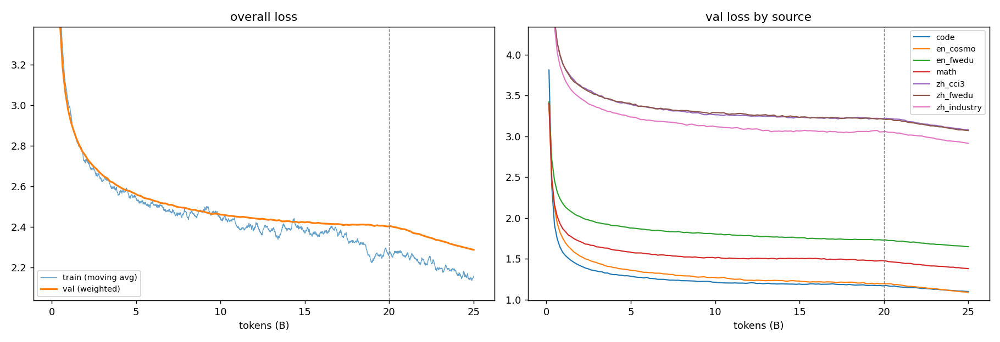

# 最终结果分析（结果分析智能体）

- 生成时间：2026-11-15 15:54:30
- 已训练 25.00B token、47,683 步；最终验证 loss 2.2879（ppl 9.85），测试 loss 2.2611
- WSD 衰减阶段（第 38,014 步起）验证 loss 下降 0.1148
- 恒定学习率阶段末期：每 1B token 验证 loss 变化 -0.0065（t=-4.1）

## 分来源

| 来源 | 中段 | 衰减起点 | 最终 | 衰减阶段下降 | 单次噪声 σ | bits/字符 | 已过遍数 | 测试 loss |
|---|---|---|---|---|---|---|---|---|
| code | 1.1997 | 1.1712 | 1.1013 | 0.0699 | 0.0021 | 0.589 | 1.9627 | 1.1328 |
| en_cosmo | 1.2408 | 1.1978 | 1.0918 | 0.106 | 0.0018 | 0.581 | 1.8351 | 1.0468 |
| en_fwedu | 1.7807 | 1.7305 | 1.651 | 0.0795 | 0.0021 | 0.966 | 2.2475 | 1.6131 |
| math | 1.5081 | 1.4793 | 1.382 | 0.0973 | 0.0018 | 0.903 | 1.7189 | 1.3625 |
| zh_cci3 | 3.249 | 3.2191 | 3.0808 | 0.1383 | 0.002 | 2.813 | 1.7468 | 3.0905 |
| zh_fwedu | 3.2637 | 3.2115 | 3.072 | 0.1395 | 0.0031 | 2.655 | 2.0849 | 2.8258 |
| zh_industry | 3.0918 | 3.0575 | 2.9145 | 0.143 | 0.0023 | 2.638 | 1.9739 | 3.0122 |

## 其他探测结论

- pass@k（原模型（final.pt））：两位数加减 pass@1 0.0269 / pass@16 0.24 → 边缘：先 SFT 或降低难度后再 RL；三位数加减 pass@1 0.0006 / pass@16 0.01 → 不适合：先 SFT；两位数×一位数 pass@1 0.0219 / pass@16 0.1 → 边缘：先 SFT 或降低难度后再 RL；一元一次方程 pass@1 0.0731 / pass@16 0.52 → 适合直接 RLVR；比较大小 pass@1 0.4938 / pass@16 0.78 → 适合直接 RLVR；中文应用题 pass@1 0.0312 / pass@16 0.31 → 适合直接 RLVR；英文应用题 pass@1 0.0394 / pass@16 0.39 → 适合直接 RLVR；GSM8K（3-shot 思维链） pass@1 0.015 / pass@16 0.16 → 边缘：先 SFT 或降低难度后再 RL
- token 探测：用真实频次检验：范数 AUC 0.9971，方向指标 AUC 1.0（≥0.8 说明权重本身就能认出罕见 token）；复述成功率：最可疑组 0%，高频组 89%；欠训练 token 明显
- 参数空间编辑：no_edit
- profiler：MFU 0.5126，46964 tok/s

## 下一步建议（按规则自动生成，需要人工判断）

1. 恒定学习率阶段末期每 1B token 验证 loss 只变化 -0.0065，数据已重复约 2.2 遍：同一份数据继续加训收益很低；若继续预训练，应先扩充唯一数据（尤其是中文和数学），而不是加步数。
2. 衰减阶段带来 0.1148 的下降，明显大于恒定阶段末期的进展：下一轮可以做"衰减比例 20% vs 30%"的对照，或在衰减阶段换入更高质量的数据（退火数据）。
3. pass@k 显示 ['一元一次方程', '比较大小', '中文应用题', '英文应用题'] 已有足够多"部分答对"的分组：可以直接用 verl 做 RLVR（GRPO）。
4. 贪心解码 4-gram 重复率 0.6481：基座模型直接对话会复读，做生成类评测或部署前需要 SFT，或者加 repetition penalty。
5. 38 道选择题的 95% 区间约 ±13 个百分点，区分不了 checkpoint：建议补一轮正式基准（C-Eval / CMMLU / HellaSwag / ARC / GSM8K / HumanEval，基座模型用 log-prob 打分）。

## 训练末期的分析结论

- 最近 8 次评估总体验证 loss 每 1B token 变化 -0.0209（t=-104.25，单次噪声 σ≈0.0007），判定 improving
- 没有来源显著变差（单次的小幅上升都在噪声范围内）
- 选择题 89%（n=38，95% 区间 76%–96%），只作参考
