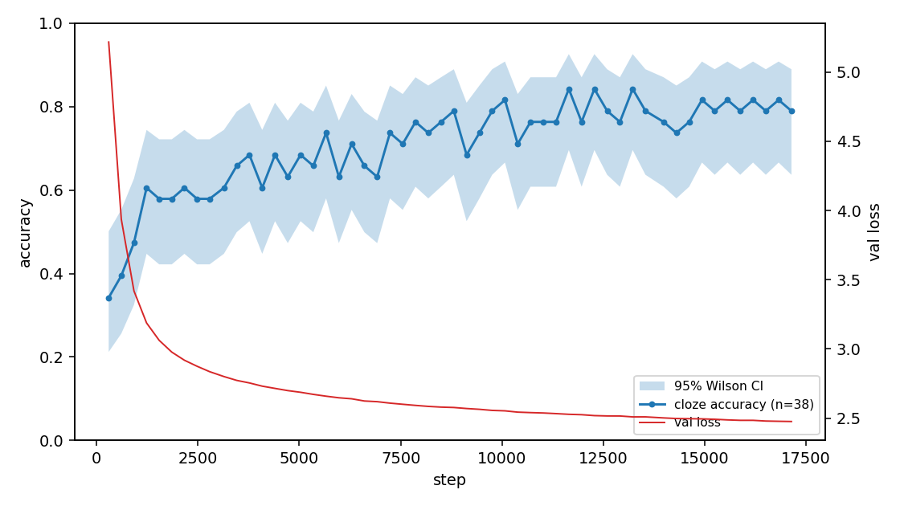

# 选择题准确率的置信区间与配对检验

- 题数 n = 38：一题 = 2.63 个百分点；准确率 80% 附近的标准误 ≈ 0.065，95% 区间半宽约 ±13%
- 相邻两次评估平均有 4.28 道题翻转（对→错或错→对）
- 最近 10 次评估：一直对 26 题，一直错 4 题，来回翻 8 题

## 配对检验（精确 McNemar）

| 对比 | 步数 | 准确率 | 只有前者对 | 只有后者对 | p 值 |
|---|---|---|---|---|---|
| 最早 vs 最新 | 300 → 17137 | 34% → 79% | 2 | 19 | 0.0002 |
| 中点 vs 最新 | 8811 → 17137 | 79% → 79% | 2 | 2 | 1.0 |
| 倒数第 5 次 vs 最新 | 15875 → 17137 | 79% → 79% | 1 | 1 | 1.0 |

p < 0.05 才能说两次评估"确实不同"；只有翻转的题数够多且方向一边倒时才会显著。

## 每次评估（最近 15 次）

| 步数 | val loss | 准确率 | Wilson 95% | bootstrap 95% |
|---|---|---|---|---|
| 12592 | 2.5163 | 30/38 = 79% | 64%–89% | 66%–92% |
| 12907 | 2.516 | 29/38 = 76% | 61%–87% | 63%–89% |
| 13222 | 2.5095 | 32/38 = 84% | 70%–93% | 71%–95% |
| 13537 | 2.5096 | 30/38 = 79% | 64%–89% | 66%–92% |
| 13985 | 2.5021 | 29/38 = 76% | 61%–87% | 63%–89% |
| 14300 | 2.4977 | 28/38 = 74% | 58%–85% | 61%–87% |
| 14615 | 2.4964 | 29/38 = 76% | 61%–87% | 63%–89% |
| 14930 | 2.4951 | 31/38 = 82% | 67%–91% | 68%–92% |
| 15245 | 2.4923 | 30/38 = 79% | 64%–89% | 66%–92% |
| 15560 | 2.4877 | 31/38 = 82% | 67%–91% | 68%–92% |
| 15875 | 2.4846 | 30/38 = 79% | 64%–89% | 66%–92% |
| 16190 | 2.4846 | 31/38 = 82% | 67%–91% | 68%–92% |
| 16505 | 2.4795 | 30/38 = 79% | 64%–89% | 66%–92% |
| 16821 | 2.4777 | 31/38 = 82% | 67%–91% | 68%–92% |
| 17137 | 2.4762 | 30/38 = 79% | 64%–89% | 66%–92% |

## 相邻评估的翻转（最近 10 对）

| 步数 | 对→错 | 错→对 | 准确率变化 | McNemar p |
|---|---|---|---|---|
| 13985 → 14300 | 1 | 0 | -2.6% | 1.0 |
| 14300 → 14615 | 2 | 3 | +2.6% | 1.0 |
| 14615 → 14930 | 2 | 4 | +5.3% | 0.6875 |
| 14930 → 15245 | 1 | 0 | -2.6% | 1.0 |
| 15245 → 15560 | 1 | 2 | +2.6% | 1.0 |
| 15560 → 15875 | 2 | 1 | -2.6% | 1.0 |
| 15875 → 16190 | 1 | 2 | +2.6% | 1.0 |
| 16190 → 16505 | 1 | 0 | -2.6% | 1.0 |
| 16505 → 16821 | 1 | 2 | +2.6% | 1.0 |
| 16821 → 17137 | 2 | 1 | -2.6% | 1.0 |

## 来回翻的题（最近 10 次中的答对率）

- [zh_知识] 长江最终注入… 答对率 80%
- [zh_数学] 12除以4等于… 答对率 60%
- [en_knowledge] Water freezes at… 答对率 20%
- [en_knowledge] The largest planet in our solar system i… 答对率 90%
- [en_common] She was very tired, so she went to… 答对率 70%
- [en_common] There are seven days in a… 答对率 40%
- [en_math] 2 + 2 =… 答对率 30%
- [zh_知识] 人体最大的器官是… 答对率 20%

## 结论怎么下

- 单次评估的准确率要带区间报告；两次评估差几个百分点通常落在区间内，不能当作能力变化。
- 比较两个 checkpoint 用配对检验（同一批题），比较两个区间是否重叠过于保守。
- 想让这个指标有分辨力，要么加题（误差 ∝ 1/√n，题数 ×4 区间才减半），要么改看逐题 log-prob 的平均（连续量，噪声小得多）。
- val loss 是约 23 万 token（7 个来源 × 32 段 × 1024）的平均，噪声远小于选择题，所以它比 cloze 更适合跟踪训练进展。

