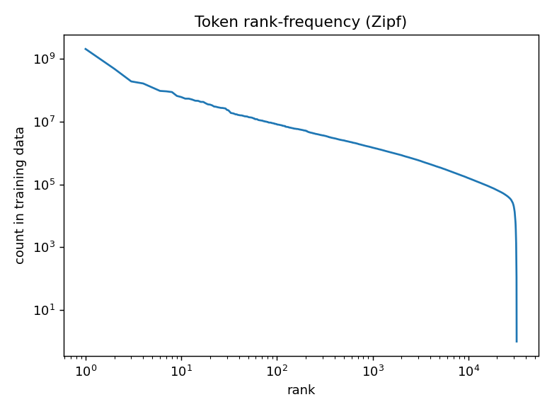
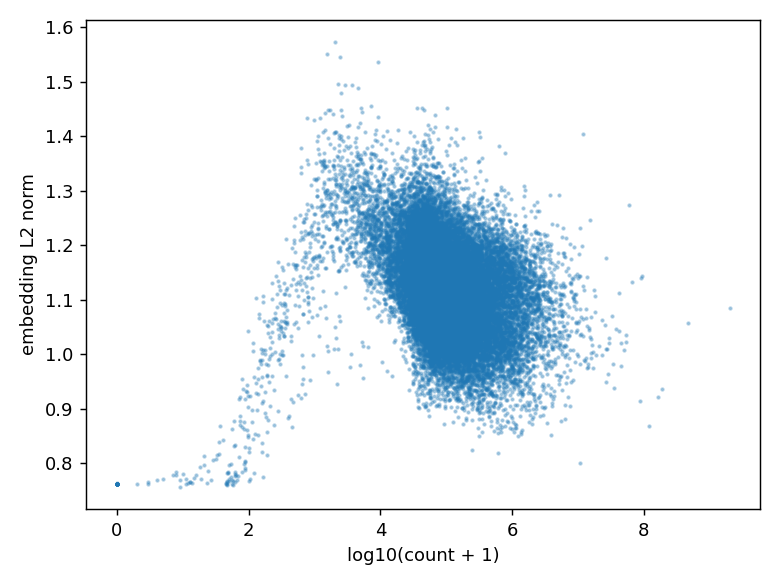
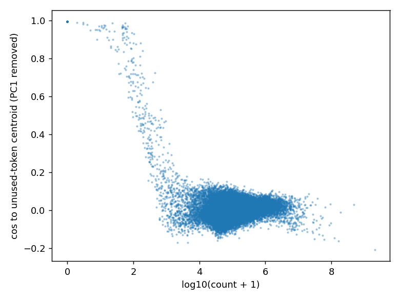

# token 频次 / 欠训练 token / 评测污染

- 时间：2026-11-15 15:52:36，用时 0.1 分钟（其中数据扫描 11.7 分钟，可能来自缓存）
- 训练数据唯一 token 12,853,991,421，训练共看过 24,999,624,704 token，约 1.945 遍（各来源采样权重不同，单个 token 的实际次数 ≈ 频次 × 该来源遍数）

## 1. 频次分布

- 非特殊 token 31,996 个；出现 0 次 21，<100 次 113，<1000 次 354
- 覆盖语料 50% / 90% / 99% 所需 token 数：441 / 11,264 / 26,309
- Zipf 斜率（秩 10–10000，log-log）：-0.897（自然语言的词约 −1；BPE 合并会让它变平）

| 频次区间 | token 数 |
|---|---|
| 0 次 | 21 |
| 1–99 | 92 |
| 100–999 | 241 |
| 1千–1万 | 887 |
| 1万–10万 | 16,185 |
| 10万–100万 | 12,943 |
| ≥100万 | 1,627 |

## 2. 欠训练 token

- 预期：初始化范数 ≈ 0.02×√1024 = 0.64；从未拿到梯度的行只受权重衰减，∏(1−lr·wd) = 0.1798 → 约 0.1151。绑定嵌入下罕见 token 仍会被 softmax 统一下压（Adam 会把这个微小但方向一致的梯度放大），所以范数可能偏小也可能偏大，更稳定的特征是"彼此很像"。
- 方向指标参照组：训练数据中出现 0 次的 21 个 token
- Spearman(log 频次, 范数) = -0.3419；Spearman(log 频次, 方向指标) = 0.2296
- 罕见（<100 次，113 个）vs 常见（≥1000 次，31642 个）的区分力：范数越小越罕见 AUC = 0.9971；方向指标越高越罕见 AUC = 1.0（0.5 = 无区分力；<0.5 表示方向相反）

| 频次区间 | token 数 | 范数中位数 | 范数 P10–P90 | 方向指标中位数 |
|---|---|---|---|---|
| 0 次 | 21 | 0.7616 | 0.7609–0.7622 | 0.9943 |
| 1–99 | 92 | 0.784 | 0.763–0.9153 | 0.8967 |
| 100–999 | 241 | 1.0754 | 0.912–1.2327 | 0.3266 |
| 1千–1万 | 887 | 1.2502 | 1.1621–1.354 | 0.0028 |
| 1万–10万 | 16,185 | 1.1338 | 1.0454–1.2314 | -0.0144 |
| 10万–100万 | 12,943 | 1.0946 | 1.002–1.1912 | 0.0126 |
| ≥100万 | 1,627 | 1.0804 | 0.9692–1.1757 | 0.0185 |

### 复述测试（少样本"原文：X\n复述："，贪心）

| 组 | 数量 | 复述成功率 |
|---|---|---|
| 指标最可疑的 50 个 | 50 | 0% |
| 出现 0 次 | 21 | 0% |
| 1–99 次 | 92 | 11% |
| 1千–1万次 | 100 | 89% |
| ≥10万次 | 100 | 89% |

失败样例：

- 指标最可疑的 50 个：`''` → `'SOFTWARE'`；`'�尬'` → `'SOFTWARE'`；`'�'` → `'SOFTWARE'`；`'�'` → `'SOFTWARE'`
- 出现 0 次：`''` → `'SOFTWARE'`；`'\x00'` → `'SOFTWARE'`；`'\r'` → `'SOFTWARE'`；`'�'` → `'SOFTWARE'`
- 1–99 次：`'\x0b'` → `'寅\n原文'`；`'�'` → `'�'`；`'�'` → `'�'`；`'urther'` → `'ream\n原文'`
- 1千–1万次：`'ginx'` → `'nginx\n原文'`；`'初为'` → `'初\n原文'`；`'实实在'` → `'实在\n原文'`；`'ikip'` → `'\n原文：'`
- ≥10万次：`'----'` → `'数据\n原文'`；`'比如'` → `'数据\n原文'`；`'出的'` → `'出\n原文'`；`'na'` → `'n\n原文'`

### 方向指标最可疑的 token（前 20）

| id | 文本 | 频次 | 范数 | 指标 |
|---|---|---|---|---|
| 4 | `''` | 0 | 0.7616 | 0.9952 |
| 14788 | `'�尬'` | 0 | 0.7612 | 0.9947 |
| 258 | `'�'` | 0 | 0.7618 | 0.9947 |
| 251 | `'�'` | 0 | 0.7615 | 0.9946 |
| 19867 | `'竞技叠杯运动'` | 0 | 0.7608 | 0.9945 |
| 197 | `'�'` | 0 | 0.7625 | 0.9945 |
| 250 | `'�'` | 0 | 0.7611 | 0.9945 |
| 252 | `'�'` | 0 | 0.761 | 0.9945 |
| 257 | `'�'` | 0 | 0.7616 | 0.9945 |
| 29859 | `'叠杯法'` | 0 | 0.7618 | 0.9943 |
| 5 | `'\x00'` | 0 | 0.7621 | 0.9943 |
| 256 | `'�'` | 0 | 0.7608 | 0.9943 |
| 18 | `'\r'` | 0 | 0.7615 | 0.9942 |
| 29422 | `'帮扶项目资产'` | 0 | 0.7621 | 0.9942 |
| 22277 | `'ptFont'` | 0 | 0.7622 | 0.9942 |
| 254 | `'�'` | 0 | 0.7617 | 0.9942 |
| 253 | `'�'` | 0 | 0.7626 | 0.9942 |
| 260 | `'�'` | 0 | 0.7611 | 0.9942 |
| 255 | `'�'` | 0 | 0.7609 | 0.9941 |
| 259 | `'�'` | 0 | 0.7621 | 0.9941 |

**结论**：用真实频次检验：范数 AUC 0.9971，方向指标 AUC 1.0（≥0.8 说明权重本身就能认出罕见 token）；复述成功率：最可疑组 0%，高频组 89%；欠训练 token 明显

## 3. GSM8K 评测污染（训练数据中的 13-gram 重叠）

**全部 test 题**（1319 题）：任一字段有重叠 74.9%

| 字段 | 有重叠（≥1 个 13-gram） | 强重叠（≥50% 的 13-gram） |
|---|---|---|
| question | 64.2% | 0.3% |
| answer | 34.6% | 0.0% |
| answer_clean | 37.8% | 0.0% |

**pass@k 实际用到的前 200 题**（200 题）：任一字段有重叠 74.5%

| 字段 | 有重叠（≥1 个 13-gram） | 强重叠（≥50% 的 13-gram） |
|---|---|---|
| question | 65.0% | 0.5% |
| answer | 32.0% | 0.0% |
| answer_clean | 35.0% | 0.0% |

- 命中位置按来源：{'zh_cci3': 59, 'en_fwedu': 18432, 'math': 50357, 'en_cosmo': 6471, 'code': 472, 'zh_industry': 10, 'zh_fwedu': 6}；不同的命中 13-gram 5754 个
- 出现最多的命中片段：
  - `' is equal to the sum of '` ×4182（{'en_fwedu': 183, 'en_cosmo': 66, 'code': 25, 'math': 3908}）
  - `', on the other hand, is '` ×3959（{'zh_cci3': 5, 'en_fwedu': 2249, 'en_cosmo': 864, 'code': 3, 'math': 838}）
  - `' both sides of the equation by '` ×2152（{'en_fwedu': 31, 'en_cosmo': 80, 'math': 2041}）
  - `' in the second half of the '` ×1802（{'zh_cci3': 1, 'zh_industry': 2, 'en_fwedu': 1616, 'en_cosmo': 23, 'code': 5, 'math': 155}）
  - `', on the other hand, was '` ×861（{'en_fwedu': 399, 'en_cosmo': 439, 'math': 23}）
  - `' What is the difference between the '` ×779（{'zh_fwedu': 1, 'en_fwedu': 103, 'en_cosmo': 5, 'math': 670}）
  - `' at the end of the first '` ×760（{'zh_cci3': 3, 'en_fwedu': 357, 'en_cosmo': 7, 'code': 16, 'math': 377}）
  - `' in terms of the number of '` ×662（{'en_fwedu': 301, 'en_cosmo': 11, 'code': 7, 'math': 343}）

判读：零星的"有重叠"多为通用短语（如 "How much money does she have left"），强重叠（题目或答案过半出现）才说明题目被收录；若强重叠比例不低，pass@k 中 GSM8K 的分数要打折看。

## 图

